# スニペット

## サンプル:フィルター {#sample-filters}

<tr style="border: 0">
    <td style="border: 0; vertical-align: top; padding-top: 30px" width="128">
        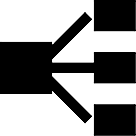
    </td>
    <td style="border: 0">
        <h3>フィルター</h3>
        
このプロジェクトは、他のグラフでフィルターとして使用するための簡単なグラフ設定を特徴としています。 <a href="/help/compositing-graphs/nodes-reference-for-com/node-library/filters/filters.md">フィルター</a>は、1つ以上の入力画像を変更またはブレンドするノードです。

        
<i>最小バージョン： 12.3.0</i>

    </td>
    <td style="border: 0; vertical-align: top; padding-top: 30px" width="128">
        
    </td>
</tr>

## 例：グラフの関数 {#sample-functions-in-sbs-graphs}

<tr style="border: 0">
    <td style="border: 0; vertical-align: top; padding-top: 30px" width="128">
        
    </td>
    <td style="border: 0">
        <h3>グラフの関数</h3>
        
このプロジェクトでは、関数グラフの概要と、<a href="/help/compositing-graphs/substance-compositing-graphs.md">Substance グラフ</a>のノードパラメーターに対する制御を拡張するためにこれらの関数を使用する方法について説明します。

        
<i>最小バージョン： 12.3.0</i>

    </td>
    <td style="border: 0; vertical-align: top; padding-top: 30px" width="128">
        
    </td>
</tr>

## サンプル：ピクセルプロセッサー {#sample-pixel-processor}

<tr style="border: 0">
    <td style="border: 0; vertical-align: top; padding-top: 30px" width="128">
        
    </td>
    <td style="border: 0">
        <h3>ピクセルプロセッサー</h3>
        
<a href="/help/compositing-graphs/nodes-reference-for-com/atomic-nodes/pixel-processor/pixel-processor.md">ピクセルプロセッサー</a>ノードは、Designerで最も複雑で強力なノードの1つです。このノードの機能を理解すると、ノードの強力で柔軟な操作が可能になり、より多様なカスタムグラフを作成できるようになります。

        
このプロジェクトでは、ピクセルプロセッサーの2つの簡単な使用例を示します。ジェネレータとフィルタです。 また、<a href="/help/function-graphs/function-graphs.md">関数グラフ</a>を使用して、さらに多くのことを行うための足がかりにもなります。

        
<i>最小バージョン： 12.3.0</i>

    </td>
    <td style="border: 0; vertical-align: top; padding-top: 30px" width="128">
        
    </td>
</tr>

## 例：華やかな生地 {#sample-ornate-fabric}

<tr style="border: 0">
    <td style="border: 0; vertical-align: top; padding-top: 30px" width="128">
        
    </td>
    <td style="border: 0">
        <h3>華やかな生地</h3>
        
<a href="../getting-started/getting-started.md">「はじめに」チュートリアルシリーズ</a>で使用されるこのプロジェクトでは、様々な手法を使用して、華やかなパターンのファブリックマテリアルを作成する方法を示します。 パターンは<a href="/help/learning-tutorials/essentials/glossary/glossary.md#subgraph">サブグラフ</a>で作成されます。

        
<i>最小バージョン： 13.0.0</i>

    </td>
    <td style="border: 0; vertical-align: top; padding-top: 30px" width="128">
        
    </td>
</tr>

## サンプル：継承 {#sample-inheritance}

<tr style="border: 0">
    <td style="border: 0; vertical-align: top; padding-top: 30px" width="128">
        
    </td>
    <td style="border: 0">
        <h3>継承</h3>
        
このプロジェクトでは、解像度やビット深度などの重要なイメージ情報をグラフ内のSubstance間で伝達するための、ノードグラフで使用できる<a href="/help/learning-tutorials/essentials/glossary/glossary.md#inheritance">継承</a>メソッドを示します。

詳細： <a href="/help/compositing-graphs/inheritance-compositing/inheritance-in-substance-compositing-graphs.md">グラフの継承</a>

        
<i>最小バージョン： 12.3.0</i>

    </td>
    <td style="border: 0; vertical-align: top; padding-top: 30px" width="128">
        
    </td>
</tr>

## サンプル：抽象ファブリック {#sample-abstract-fabric}

<tr style="border: 0">
    <td style="border: 0; vertical-align: top; padding-top: 30px" width="128">
        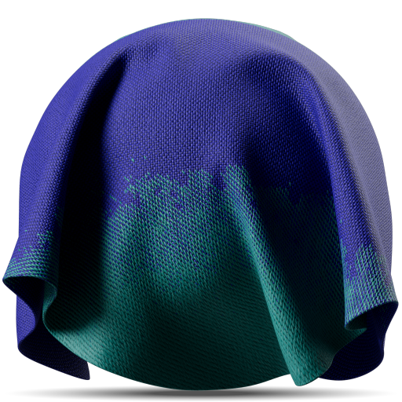
    </td>
    <td style="border: 0">
        <h3>抽象的ファブリック</h3>
        
シンプルなファブリックマテリアルのテンプレート。 このテンプレートは、Tile Generatorとタイルサンプラーを使って細かい平織りを作成する方法と、異なるパターンをブレンドする方法を示しています。

        
<i>最小バージョン： 15.1.0</i>

    </td>
    <td style="border: 0; vertical-align: top; padding-top: 30px" width="128">
        
    </td>
</tr>

## サンプル：レンガウォール {#sample-brick-wall}

<tr style="border: 0">
    <td style="border: 0; vertical-align: top; padding-top: 30px" width="128">
        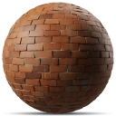
    </td>
    <td style="border: 0">
        <h3>レンガ壁</h3>
        
モルタルを使用したシンプルなレンガ壁用テンプレート。 このサンプルは、Tile Generatorノードから完全なマテリアルを構築する方法を示し、タイリングパターンを操作するために必要なノードを紹介します。

        
<i>最小バージョン： 15.1.0</i>

    </td>
    <td style="border: 0; vertical-align: top; padding-top: 30px" width="128">
        
    </td>
</tr>

## サンプル:レザー {#sample-leather}

<tr style="border: 0">
    <td style="border: 0; vertical-align: top; padding-top: 30px" width="128">
        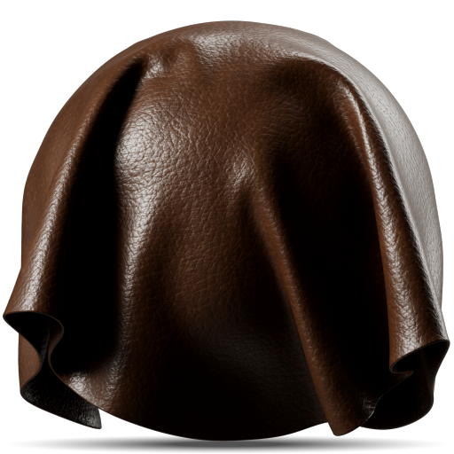
    </td>
    <td style="border: 0">
        <h3>レザー</h3>
        
シンプルなレザーマテリアル用のテンプレート。 このテンプレートは、リアルなレザーベースを作成するための簡単なテクニックを示しています。

        
<i>最小バージョン： 15.1.0</i>

    </td>
    <td style="border: 0; vertical-align: top; padding-top: 30px" width="128">
        
    </td>
</tr>

## サンプル：金属 {#sample-metal}

<tr style="border: 0">
    <td style="border: 0; vertical-align: top; padding-top: 30px" width="128">
        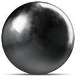
    </td>
    <td style="border: 0">
        <h3>メタル</h3>
        
シンプルな板金マテリアル用のテンプレート。 このサンプルは、平坦な色とHeightを持ちながら豊かな仕上がりになっている特徴を持つ軽量なマテリアルにおいて、ラフネスチャンネルと通常チャンネルが重い作業を行う方法を示します。

        
<i>最小バージョン： 15.1.0</i>

    </td>
    <td style="border: 0; vertical-align: top; padding-top: 30px" width="128">
        
    </td>
</tr>

## サンプル：キルトサテン {#sample-quilted-satin}

<tr style="border: 0">
    <td style="border: 0; vertical-align: top; padding-top: 30px" width="128">
        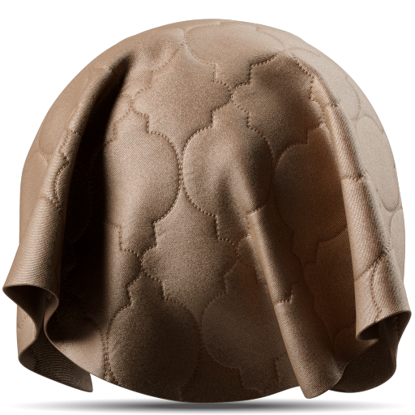
    </td>
    <td style="border: 0">
        <h3>キルトサテン</h3>
        
シンプルなキルトサテンマテリアルのテンプレートです。 このテンプレートは、Tile Generatorを使用して複雑な織り方を作成する方法と、スプラインに沿ってステッチを散乱する方法を示します。 また、RGBチャンネルでパッキングマスクを使うと、シェイプの散布ワークフローを効率化できます。

        
<i>最小バージョン： 15.1.0</i>

    </td>
    <td style="border: 0; vertical-align: top; padding-top: 30px" width="128">
        
    </td>
</tr>

## サンプル：再生プラスチック {#sample-recycled-plastic}

<tr style="border: 0">
    <td style="border: 0; vertical-align: top; padding-top: 30px" width="128">
        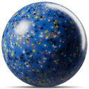
    </td>
    <td style="border: 0">
        <h3>再生プラスチック</h3>
        
シンプルでカラフルなプラスチックのマテリアルのテンプレート。 このテンプレートは、カラーパレットノードを使用して配色をすばやく繰り返すための基本的な設定を示します。

        
<i>最小バージョン： 15.1.0</i>

    </td>
    <td style="border: 0; vertical-align: top; padding-top: 30px" width="128">
        
    </td>
</tr>

## サンプル：錆ついたボルト {#sample-rusty-bolts}

<tr style="border: 0">
    <td style="border: 0; vertical-align: top; padding-top: 30px" width="128">
        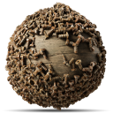
    </td>
    <td style="border: 0">
        <h3>錆びたボルト</h3>
        
錆びたボルトが散らばっているサーフェスのテンプレート。 このテンプレートは、高度なスキャッタリングテクニック、パターンの3D回転、および個々のパターン上へのテクスチャマッピングを備えたSDFノードとシェイプスプラッタV2ノードを紹介します。

        
<i>最小バージョン： 15.1.0</i>

    </td>
    <td style="border: 0; vertical-align: top; padding-top: 30px" width="128">
        
    </td>
</tr>

## サンプル：石の地面 {#sample-stone-ground}

<tr style="border: 0">
    <td style="border: 0; vertical-align: top; padding-top: 30px" width="128">
        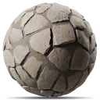
    </td>
    <td style="border: 0">
        <h3>石造りの地面</h3>
        
Heightに関する詳細な作業を含む石造りのマテリアルのテンプレートです。 このテンプレートは、Flood Fill節点を使用してパターンのバリエーションを追加し、ノイズを変更し、Heightデータを使用してマスクを抽出するための、より高度なワークフローを示します。

        
<i>最小バージョン： 15.1.0</i>

    </td>
    <td style="border: 0; vertical-align: top; padding-top: 30px" width="128">
        
    </td>
</tr>

## サンプル：様式化されたモザイク {#sample-stylized-mosaic}

<tr style="border: 0">
    <td style="border: 0; vertical-align: top; padding-top: 30px" width="128">
        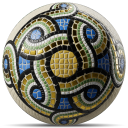
    </td>
    <td style="border: 0">
        <h3>定型化されたモザイク</h3>
        
モザイクマテリアルのテンプレート。 このテンプレートでは、スプラインノード、およびUVやHeightなどのスプラインデータを使用して複雑なシェイプにパターンを分散する方法について説明します。 また、グラフ全体でマスクを抽出して使用するための多くのトリックを使用します。

        
<i>最小バージョン： 15.1.0</i>

    </td>
    <td style="border: 0; vertical-align: top; padding-top: 30px" width="128">
        
    </td>
</tr>

## サンプル：木材 {#sample-wood}

<tr style="border: 0">
    <td style="border: 0; vertical-align: top; padding-top: 30px" width="128">
        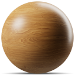
    </td>
    <td style="border: 0">
        <h3>木材</h3>
        
シンプルな木目の断面マテリアルのテンプレート。 このサンプルには、特に木目を作るのに役立つテクニックが満載です。グラフの光を維持しながら、リアルな木目を作り出すことができます。

        
<i>最小バージョン： 15.1.0</i>

    </td>
    <td style="border: 0; vertical-align: top; padding-top: 30px" width="128">
        
    </td>
</tr>
