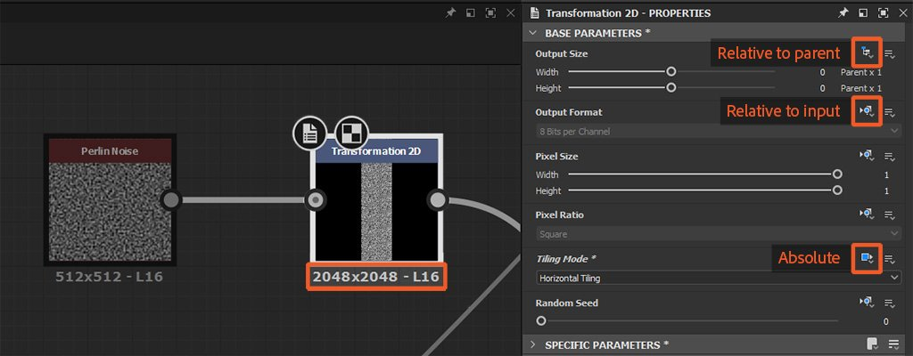
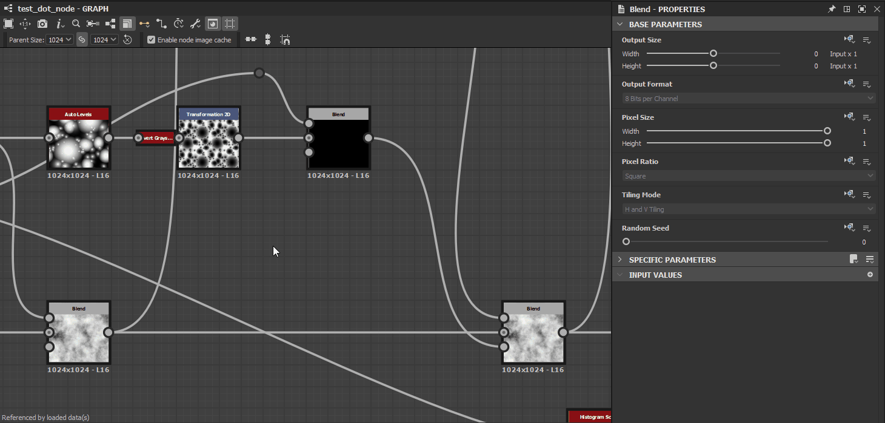
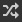
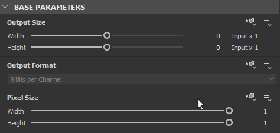
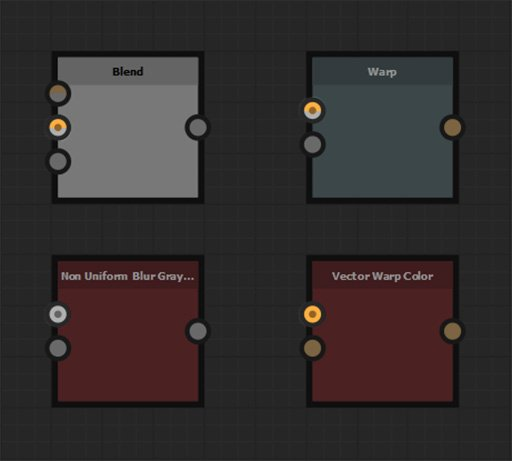
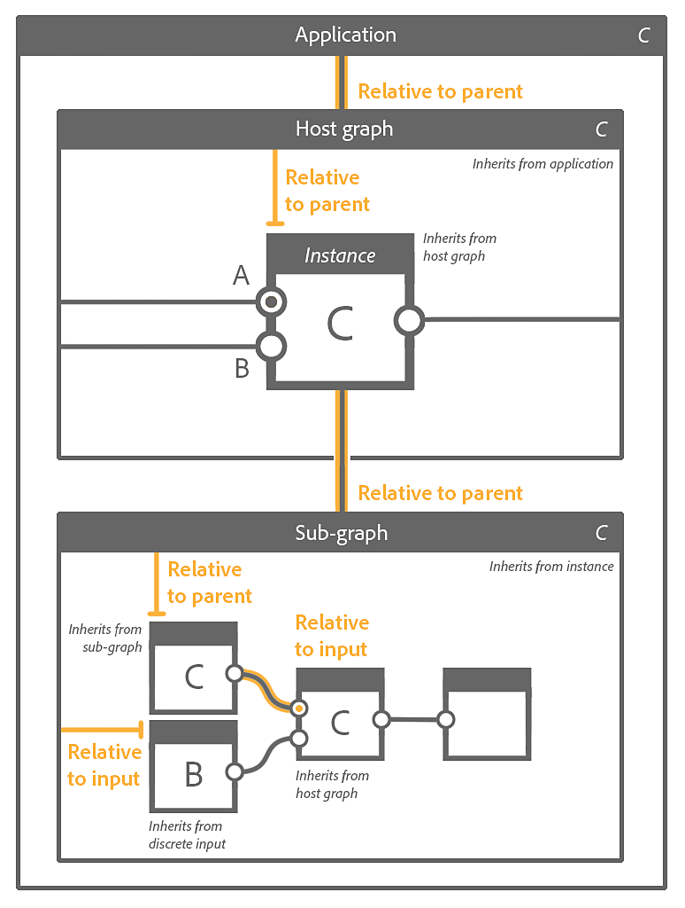
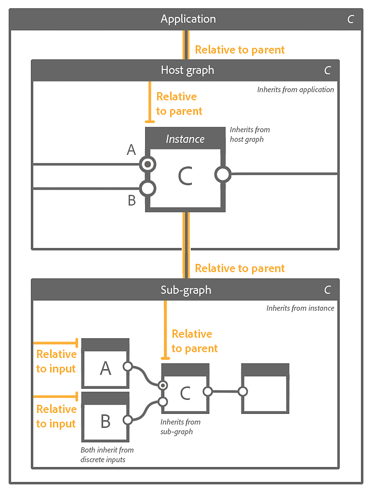
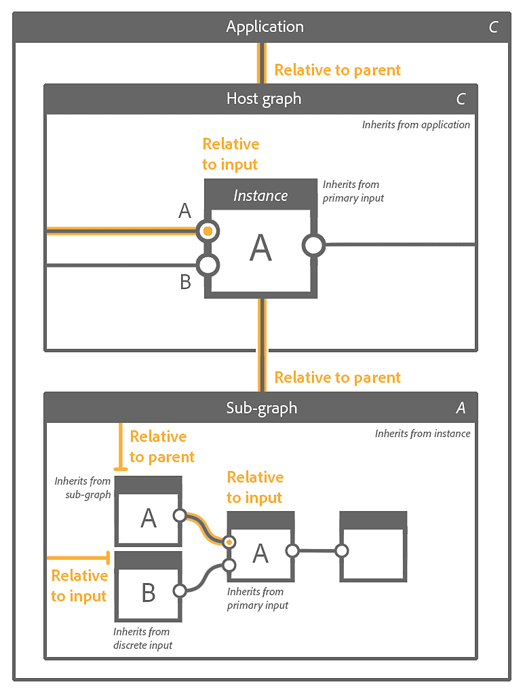
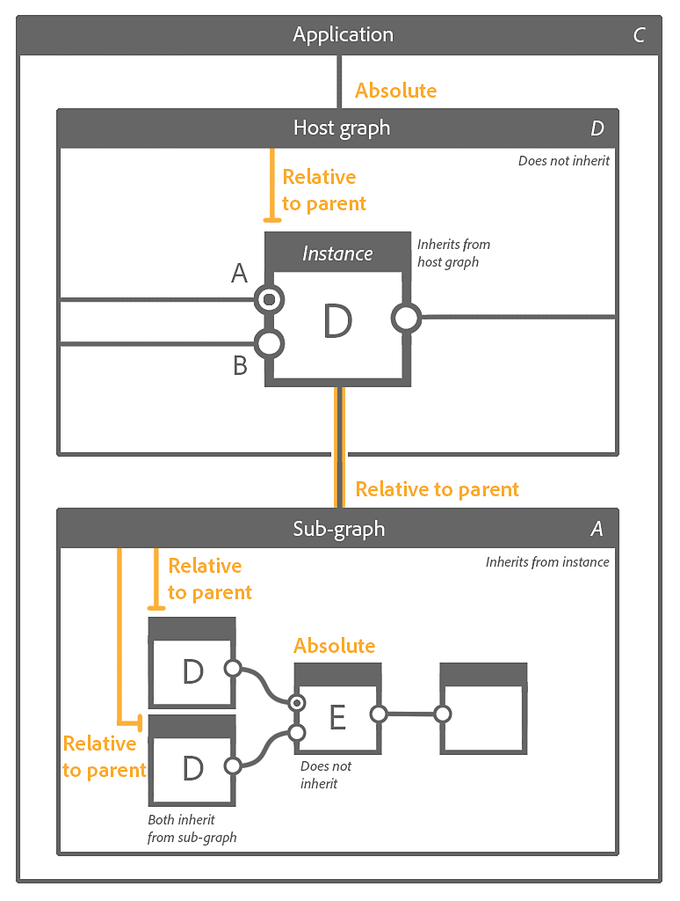
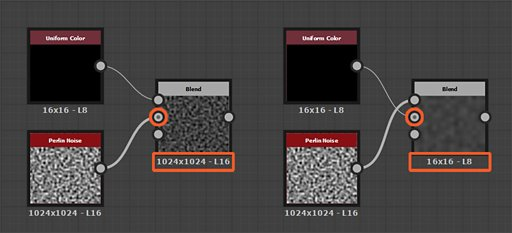

# Substance グラフの継承

[Substance 3D Designer](https://www.adobe.com/jp/products/substance3d-designer.html)内の[Substanceグラフ](../../compositing-graphs/substance-compositing-graphs.md)で継承がどのように適用され、グラフの出力に与える影響について説明します。

{width="1400px"}

## 概要

グラフ内のすべてのノードは、ソースから一部のパラメーターの値を&#x200B;*継承*&#x200B;できます。 継承とは、ソース内の値を変更すると、ソースを継承するすべてのノードで&#x200B;*その変更を実行*&#x200B;することを意味します。 これは、Substance 3D Designerがパラメトリックアセットを作成する際の基本的な土台となる概念の1つです。

>[!NOTE]
>
> 継承を説明する注釈付きのプロジェクトファイルは、このドキュメントの[サンプルSubstanceグラフ](../../compositing-graphs/sample-compositing-graphs/sample-substance-compositing-graphs.md)セクションにあります。

### 継承方式

<table>
<tr style="border: 0;">
<td style="border: 0;" valign="top">

{width="128px"}

<b>絶対</b>

継承がありません。値はパラメーターに&#x200B;*任意かつローカル*&#x200B;で定義されます

</td>
<td style="border: 0;" valign="top">

{width="128px"}

<b>入力に対する相対</b>

値は、ノードの&#x200B;*プライマリ入力*&#x200B;に接続されているデータから継承されます

</td>
<td style="border: 0;" valign="top">

{width="128px"}

<b>親に相対的</b>

値はノードまたはグラフの&#x200B;*親*&#x200B;から継承されます

</td>
</tr>
</table>

継承メソッドは、ノードの[基本パラメーター](../../compositing-graphs/graph-parameters/graph-parameters.md)に適用されます。これは、すべてのノードのビヘイビアーの&#x200B;*基本的な側面*&#x200B;を制御する共通パラメーターのセットです。 次のパラメーターがあります。

* **出力サイズ**
* **出力形式** （ビット深度）
* **ピクセルサイズ**
* **ピクセル比**
* **タイリングモード**
* **ランダムシード**

これにより、*one*&#x200B;ノードでの変更が、そのノードから&#x200B;*下流のすべてのノード*&#x200B;の解像度、精度、およびタイリングの動作に与える影響について理解できます。

>[!WARNING]
>
> このページで説明する概念を理解するための重要なお知らせです。*インスタンス化*&#x200B;は、別のグラフ[&#128279;](../../compositing-graphs/creating-compositing-gra/graph-instances-sub-gra/graph-instances-sub-graphs.md)のグラフを表すノードであり、独自の&#x200B;*個別のパラメーター値*&#x200B;を持つため、*インスタンス*&#x200B;という用語が使用されています。\
> 例えば、同じグラフ内の2つの[Perlin ノイズ](../../compositing-graphs/nodes-reference-for-com/node-library/texture-generators/noises/perlin-noise/perlin-noise.md)ノードは、両方とも&#x200B;*独自のパラメーター値セット*&#x200B;を持つ&#x200B;*同じ*&#x200B;ソースグラフ （`noise_perlin_noise.sbs`の`perlin_noise`）を表します。

>[!NOTE]
>
> **出力サイズ：** Heightの値&#x200B;*が幅の値*&#x200B;と一致するようにロックボタンを使用してください\
> **ランダムシード：** ボタンを使用して、新しいランダム値をランダムシードに割り当てます。

## 変更の実行

### 継承方式の変更

プロパティパネルでは、ノードのプロパティの[基本パラメーター](../../compositing-graphs/graph-parameters/graph-parameters.md)セクションに一覧表示されているすべてのパラメーターに、ラベルの反対側に(icon) <b>継承メソッドの設定</b>ドロップダウンボタンがあります。\
このボタンをクリックすると、パラメーターに使用する継承方式を選択できます。

{width="512px"}

ほとんどの場合、*グラフ*&#x200B;の基本パラメーターは&#x200B;*入力に対して相対的*&#x200B;に設定され、ノードをチェーン接続するプロシージャルの動作を利用できます。また、*ノード*&#x200B;の基本パラメーターは&#x200B;*親に相対的*&#x200B;に設定されているため、グラフが使用されているコンテキストに合わせてグローバルパラメーターを調整できます。

### 継承された値の微調整

[出力サイズ](../../compositing-graphs/output-size/output-size.md)、ピクセルサイズ、ランダムシードなどの一部の基本パラメーターは、継承された値&#x200B;*に対して*&#x200B;相対的に変更できます。

たとえば、Output Sizeパラメーターで&#x200B;*Relative to...*&#x200B;継承メソッドを使用する場合、値または`(1, -1)`は、Xの継承された値が&#x200B;*上*&#x200B;の2乗、Yの継承された値が&#x200B;*下*&#x200B;の2乗であることを示します。次に例を示します。

* 継承された値： `(9, 9)` (`2^9, 2^9 = 512, 512`)
* 相対値： `(1, -1)` (`2^(9+1), 2^(9-1) = 256, 1024`)

>[!NOTE]
>
> [出力サイズ](../../compositing-graphs/output-size/output-size.md)ページは、この重要なBaseパラメーターの詳細を掘り下げており、ノードの最終解像度の計算方法を理解するために読むことをお勧めします。

関数がBaseパラメーターに適用される場合、関数の結果もパラメーターの継承メソッドを使用して解釈されます。\
出力サイズの例を念頭に置いて、継承された解像度をXとYの2倍に上げることを目的とした関数は、`(2, 2)` 整数2の値を出力する必要があります。

## ノードとグラフの親

継承方式を使用する場合は、具体的なコンテキストで親が何であるかを正確に理解する必要があります。

ノードの親は、ノードが存在する&#x200B;*グラフ*&#x200B;です。

グラフの親は、次の場所に存在する&#x200B;*コンテキスト*&#x200B;です：

* そのグラフが&#x200B;*グラフ*&#x200B;として別のホストグラフにインスタンス化されたサブインスタンス化である場合、そのサブグラフの親は&#x200B;*インスタンス化*&#x200B;です。 そのインスタンス化の親は&#x200B;*ホストグラフ*&#x200B;です。
* そのグラフーがルートグラフーである場合、親は&#x200B;*application自体*&#x200B;であり、指定されたパラメーターに対してアプリケーションが設定した値です。 たとえば、グラフは、[グラフビューのツールバー](../../interface/the-graph-view/the-graph-view.md)の<b>Parent Size</b>パラメーターセットから継承されます。

>[!WARNING]
>
> パッケージをSubstance 3Dアセットファイル(SBSAR)に公開する際に、親が&#x200B;*そのまま*&#x200B;適用されます。 つまり、パラメーターを&#x200B;*Absolute*&#x200B;継承メソッドに設定すると、そのパラメーターは公開されたアセット内の現在の値に&#x200B;*ロック*&#x200B;されます。\
> これは、たとえば、[ビットマップ](../../compositing-graphs/nodes-reference-for-com/atomic-nodes/bitmap/bitmap.md)のノードや[最適化の目的](../../learning-tutorials/essentials/best-practices/performance-optimization/performance-optimization-guidelines.md)には望ましいことですが、グラフで作業する場合は、その他の方法で&#x200B;*明確で意図的な目的*&#x200B;がない限り、*相対値…*&#x200B;継承方式を使用することを&#x200B;*強く*&#x200B;お勧めします。

### コンテキスト内編集

グラフインスタンス グラフで[コンテキスト内編集](../../compositing-graphs/creating-compositing-gra/graph-instances-sub-gra/graph-instances-sub-graphs.md)を使用する場合、ノードの親は&#x200B;*インスタンス化*&#x200B;です。 この場合、グラフはインスタンス化から基本パラメーターを継承するため、[グラフビューのツールバー](../../interface/the-graph-view/the-graph-view.md)の<b>親サイズ</b>の設定は&#x200B;*無効*&#x200B;になります。

このトレイトはコンテキスト編集の&#x200B;*ポイント*&#x200B;であり、継承メソッドを設定し、ノードの基本パラメーターの現在の値を評価する場合は、*因数分解する*&#x200B;必要があります。

## 複数の入力がある継承

グラフに複数の入力がある場合、各入力は、継承方式に応じて、個別の入力データまたはグラフから継承されます。

<table>
<tr style="border: 0;">
<td style="border: 0;" valign="top">

{width="128px"}

<b>入力に対する相対</b>

入力は、グラフの基本パラメーターに関係なく、個別の入力データから継承されます。 これは、入力ごとのデータを制御する場合に非常に便利です。

</td>
<td style="border: 0;" valign="top">

{width="128px"}

<b>親に相対的</b>

入力はグラフから受け継がれ、受け取ったデータはそれに応じて適応されます。

</td>
<td style="border: 0;" valign="top">

</td>
</tr>
</table>

### プライマリ入力

<table>
<tr style="border: 0;">
<td style="border: 0;" valign="top">

<table>
<tr style="border: 0;">
<td style="border: 0;" valign="top">

{width="48px"}

</td>
<td style="border: 0;" valign="top">

{width="48px"}

</td>
<td style="border: 0;" valign="top">

{width="48px"}

</td>
</tr>
</table>

入力の1つをグラフの&#x200B;**プライマリ入力**&#x200B;として設定するには、[入力](../../compositing-graphs/nodes-reference-for-com/atomic-nodes/input-color/input-color.md)ノードで&#x200B;**RMB**&#x200B;をクリックし、コンテキストメニューの&#x200B;**プライマリ入力として設定**&#x200B;オプションを選択します。

</td>
<td style="border: 0;" valign="top">

</td>
</tr>
</table>

グラフがインスタンス化として別のグラフにインスタンス化されると、*入力を基準とする*&#x200B;に設定されたすべてのインスタンス化の基本パラメーターは、*その入力*&#x200B;に接続されたデータを継承します。 インスタンス化のメイン入力は、コネクターに小さな暗いドットが表示されている場合があります。

*親に相対的*&#x200B;に設定されているその他の入力は、プライマリ入力から継承される&#x200B;*インスタンス化\**から継承される*&#x200B;グラフ*から継承されるため、同じ基本パラメーターの値を継承します。

\*：これは、グラフが*&#x200B;親に相対的*継承メソッドを使用している場合です。

## 例

以下では、さまざまな継承事例と、次のアクターで設定された継承方式の相互運用について、上から下に示します。

1. アプリケーション
1. 宿主グラフ
1. 宿主グラフのインスタンス化
1. サブグラフ - インスタンス化が参照するグラフ
1. サブグラフ内のノード

アクターに対して設定された&#x200B;*継承法*&#x200B;は、その真上にオレンジ色で表示されます。 ソースへの&#x200B;*継承の流れ*&#x200B;は、オレンジ色の線で表示されます。

文字は、基本パラメーターの&#x200B;*個別のセット*&#x200B;を表し、どのアクターによってどのデータが継承されるかに従う必要があります。

<table>
<tr style="border: 0;">
<td style="border: 0;" valign="top">

**例A**

{zoomable="yes"}

</td>
<td style="border: 0;" valign="top">

**例B**

{zoomable="yes"}

</td>
</tr>
</table>

<table>
<tr style="border: 0;">
<td style="border: 0;" valign="top">

**C**&#x200B;の例

{zoomable="yes"}

</td>
<td style="border: 0;" valign="top">

**例D**

{zoomable="yes"}

</td>
</tr>
</table>

## 継承の問題のトラブルシューティング

グラフを構築して複雑にすると、継承が原因で予期しない結果が生じることがあります。 ノードの出力の解像度または精度が正しくない場合（ビット深度など）、*継承チェーンを上がって*&#x200B;これらの値の出所を特定する必要があります。

最初に、節点のすぐ下に表示されるデータを確認することをお勧めします。これは、節点の&#x200B;*最初の出力*&#x200B;による出力画像の解像度、色の形式、および精度です。 解決策の理解は簡単ですが、2番目のデータは詳しく説明する価値があります。

* *文字のプレフィックス*&#x200B;は、画像の色の形式を参照しています：
  * <b>L</b>: 輝度 （グレースケール）
  * <b>C</b>:カラー
* *数値*&#x200B;は、画像のビット深度を示します。精度は小さいものから大きいものまで様々です。
  * <b>8</b>: 8ビット整数 （0 ～ 1の256ステップ）
  * <b>16</b>: 16ビット整数 （0 ～ 1で65 536ステップ）
  * <b>16F</b>: 16ビット浮動小数点（0 ～ 1を超える低精度値、負の値を含む）
  * <b>32F</b>: 32ビット浮動小数点数（0 ～ 1を超える高精度の値、負数を含む）

ノードに複数の出力がある場合は、次の2つの簡単な方法で解像度と精度を確認できます。

* *出力コネクター*&#x200B;の<b>LMB</b>をダブルクリックして[2D ビュー](../../interface/2d-view/2d-view.md)に画像を表示し、2D ビュービューポートの&#x200B;*左下隅*&#x200B;に表示される画像を確認します
* [レベル](../../compositing-graphs/nodes-reference-for-com/atomic-nodes/levels/levels.md)または[変形 2D](../../compositing-graphs/nodes-reference-for-com/atomic-nodes/transformation-2d/transformation-2d.md)ノードを作成し、その入力を確認する出力に接続します。 ノードは既定で&#x200B;*出力から継承*&#x200B;します。その後、ノードの下の値を確認できます。

これで、グラフのノードチェーンを上に移動して、予期しない値が表示される&#x200B;*最初のノード*&#x200B;を見つけることができます。 基本パラメーターの継承方式を確認してください。

何も問題がなく、ノードがインスタンス化である場合は、さらに深く進み、そのインスタンス化が参照するグラフを開く必要があります。 グラフの出力ノードから上流に向かうプロセスを繰り返します。

### 一般的な例

特に、*基本入力*&#x200B;のコンセプトは簡単に&#x200B;*見落とされる*&#x200B;ため、継承の問題を引き起こす可能性があります。

[ブレンド](../../compositing-graphs/nodes-reference-for-com/atomic-nodes/blend/blend.md)ノードは非常に頻繁に使用されているため、この影響を受けやすくなっています。 <b>Background</b>入力はプライマリ入力です。

{width="512px"}

2つの入力をブレンドする順序に注意する必要があります。グラフ度を下げておきたい入力は、背景入力にコネクトする必要があります。必要なブレンドモードが可能な場合です。 そうでない場合は、ブレンドノードのベースパラメータとその継承方式を調整して補正する必要があります。
