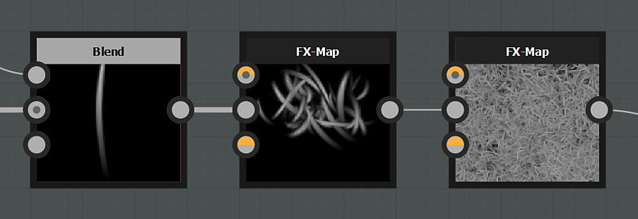

# FX-Map

<table>
<tr style="border: 0;">
<td style="border: 0; width:33.33%; vertical-align:top" width="33.33%" valign="top">

{width="100%"}

<b>イン：</b> アトミックノード

</td>
<td style="border: 0; width:66.66%; vertical-align:top" width="66.66%" valign="top">

FX-Mapは、画像やパターン入力を繰り返し複製したり再分割したり、パラメーターや論理関数を使用して各パターンの分布を制御したりできます。

これは、アプリケーションで利用可能な最も強力なアトミックノードの1つであり、最も複雑なノードです。

</td>
</tr>
</table>

<table>
<tr style="border: 0">
<td style="border: 0; width: 15%" width="15%"></td>
<td style="border: 0; text-align: center" align="center"></td>
<td style="border: 0; width: 15%" width="15%"></td>
</tr>
</table>

[ピクセルプロセッサー](../../../../compositing-graphs/nodes-reference-for-com/atomic-nodes/pixel-processor/pixel-processor.md)と同様に、このノードの動作と出力を決定する関数を定義および作成する操作はユーザーが行います。

>[!TIP]
>
> [専用ガイド](../../../../function-graphs/fxmaps/fxmaps.md)を参照して、FX-Mapプロセスの詳細を確認し、理解してください。

>[!IMPORTANT]
>
> FX-Mapノードを使用する前に、ソフトウェアに関するあらゆる側面に精通し、パラメーター用の[数学関数](../../../../function-graphs/function-graphs.md)を作成することに問題がないことを推奨します。

他のノードとは異なり、FX-Mapのビヘイビアーの大部分は、パラメーターではなく、内部のFX-Map関数を編集することによって[決定されることに注意してください](../../../../function-graphs/fxmaps/fxmaps.md)。

|  |  |
| --- | --- |
| <b>カラーモード</b> *ブーリアン* | グレースケールとカラー出力画像を切り替えます。 カラーは、グレースケールよりもはるかに低速になります。 |
| <b>背景</b> *浮動小数/浮動小数4* | 結果を合成する背景色を設定します。 |
| <b>領域のレンダリング</b> *浮動小数4* | FX-Mapの各辺の開始ピクセル範囲を指定すると、伸縮効果が得られます。 |
| <b>タイリングの地域</b> *浮動小数4* | FX-Mapのタイリングのオフセットを指定します。 |
| <b>外側をカリング</b> *ブーリアン* | 通常の範囲から外れる[カリング](../../../../learning-tutorials/essentials/glossary/glossary.md#culling)パターンで最適化を実行します。 |
| <b>ラフネス</b> *浮動小数* | 深度と不透明度の乗数として機能します。 FXマップのブレンドプロセスにバイアスを適用します。 |
| <b>グローバル不透明度</b> *浮動小数* | FX-mapの出力のグローバル不透明度を設定します。 |

## FX-Mapガイド

*近日公開。*

## 入力コネクター

|  |  |
| --- | --- |
| <b>背景</b> *グレースケール/カラー*&#x200B;プライマリ | 出力画像の背景色です。 |
| <b>入力画像 #</b> *グレースケール/カラー* |  |

## 例

