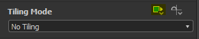

# 変形 2D

<table>
<tr style="border: 0;">
<td style="border: 0; width:33.33%; vertical-align:top" width="33.33%" valign="top">

{width="100%"}

<b>イン：</b> アトミックノード

</td>
<td style="border: 0; width:66.66%; vertical-align:top" width="66.66%" valign="top">

画像に変換、回転、スケーリング、対称、シアーの 2D 変形行列を適用します。

これは、Photoshopの変形(Ctrl+T)やSubstance 3D Painterの2Dマッピングマニピュレーターを使用するのと非常に似ています。

</td>
</tr>
</table>

<table>
<tr style="border: 0">
<td style="border: 0; width: 15%" width="15%"></td>
<td style="border: 0; text-align: center" align="center"></td>
<td style="border: 0; width: 15%" width="15%"></td>
</tr>
</table>

これは非常に便利で広く応用されているノードで、タイリングを上げたり、タイリングを取り除いたり、イメージを特定の場所に配置したり、入力を伸縮したり押しつぶしたりすることが可能です。

ただし、特定の用途に完全に一致することはできないため、次のノードが適している可能性があります。[セーフ変形](../../../../compositing-graphs/nodes-reference-for-com/node-library/filters/transforms/safe-transform/safe-transform.md)、[非正方形変形](../../../../compositing-graphs/nodes-reference-for-com/node-library/filters/transforms/non-square-transform/non-square-transform.md)、[クアッド変形](../../../../compositing-graphs/nodes-reference-for-com/node-library/filters/transforms/quad-transform/quad-transform.md)および[台形変形](../../../../compositing-graphs/nodes-reference-for-com/node-library/filters/transforms/trapezoid-transform/trapezoid-transform.md)。

>[!TIP]
>
> タイリングを無効にする
> 
> &#39;タイリングモード&#39; [基本パラメーター](../../../../glossary/glossary.md)の[継承メソッド](../../../../glossary/glossary.md)を&#39;絶対&#39;に設定すると、パラメーター値を&#39;タイリングなし&#39;に設定できます：
> 
> 

>[!NOTE]
>
> ノードのプロパティのスケールと回転の値は、現在の変換に対する&#x200B;*相対値*&#x200B;であり、[適用]をクリックするまで2D ビューに適用されません。

## パラメーター

|  |  |
| --- | --- |
| <b>変換行列</b> *浮動小数4* | 直接編集する基になるマトリックスの変形を開きます。 回転とスケールを変更できます。 2D ビューのギズモを使用して調整することもできます。   警告：ビューに直接関連付けられるものではなく、ステップごとに適用できる相対調整です。 |
| <b>オフセット</b> *浮動小数2* | イメージの2Dディスプレイスメントを定義します。 2D ビュー内のギズモを使用して位置やオフセットを調整することもできます。   2D ビュー出力に直接関連します。 |
| <b>ミップマップモード</b> *整数* | 手動の[フィルタリング](../../../../glossary/glossary.md)レベルに切り替えることができます。これにより、テクスチャミップマップを使用して画像のノイズを減らすことができます。 |
| <b>ミップマップレベル</b> *整数* | 使用する[ミップマップ](../../../../glossary/glossary.md)レベルを設定します。     *&#39;ミップマップモード&#39;が&#39;手動&#39;に設定されている場合に使用可能* |
| <b>マットの色</b> *浮動小数4* | 変形のタイリングが無効な場合に背景として使用される色です。 つまり、変形された入力が出力の一部を覆っていない場合に使用するカラーを設定します。   RGBAカラーで作業している場合は、透明にすることができます。 |
| <b>フィルタリング</b> *整数* | 使用するダウンサンプリング方法を設定します。 ミップマップレベル量を減らしても特に効果がありません。 |

## 入力コネクター

|  |  |
| --- | --- |
| <b>入力</b> *グレースケール/カラー*&#x200B;プライマリ | 変形する画像。 |

## 例

*近日公開。*
