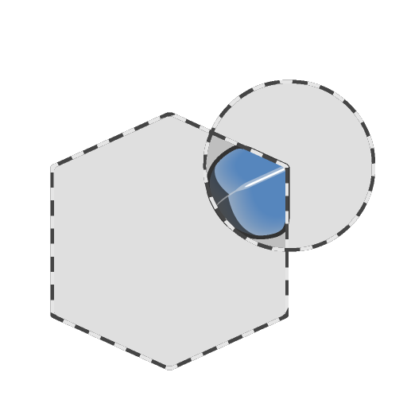

# 交差のスムーズ

<table>
<tr style="border: 0;">
<td width="33.33%" style="border: 0;" valign="top">

<b>イン：</b> SDF 関数 >演算子

</td>
<td width="100.00%" style="border: 0;" valign="top">

## 説明

2つのSDF図形に共通の体積を返します。2つの図形が重なり合う場所に作成される体積であり、交差のエッジのスムージングを調整することができます。

</td>
</tr>
</table>

>[!INFO]
> 
> SDF 関数に関する概念やワークフローについて詳しくは、専用ページ（[SDF 関数の操作](../../../../../../learning-tutorials/nodes/working-with-sdf-functions/working-with-sdf-functions.md)）を参照してください

## 入力

|  |  |
| :--- | :--- |
| <b>SDF 1</b> *浮動小数* | 最初のSDFシェイプ。 |
| <b>SDF 2</b> *浮動小数* | 2番目のSDFシェイプ。 |
| <b>Smoothness</b> *浮動小数* | 2つのSDF形状の交点のエッジのSmoothness。  <i>注：</i>滑らかさの半径が交差する部分にハードエッジが表示されることがあります。  <i>既定： 0</i> |
