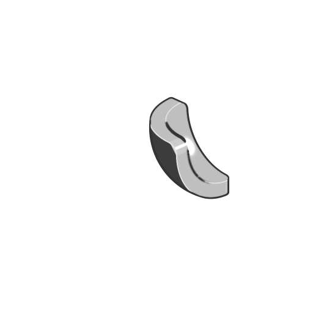

# 交差サーフェス

<table>
<tr style="border: 0;">
<td width="33.33%" style="border: 0;" valign="top">

<b>イン：</b> SDF 関数 >演算子

</td>
<td width="100.00%" style="border: 0;" valign="top">

## 説明

別のSDF図形と交差する基本SDF図形の部分のサーフェスを、Thicknessを調整して返します。

</td>
</tr>
</table>

>[!INFO]
> 
> SDF 関数に関する概念やワークフローについて詳しくは、専用ページ（[SDF 関数の操作](../../../../../../learning-tutorials/nodes/working-with-sdf-functions/working-with-sdf-functions.md)）を参照してください

## 入力

|  |  |
| :--- | :--- |
| <b>基本SDF</b> *浮動小数* | 作成されるサーフェスの基になるSDFシェイプ。 |
| <b>交差するSDF</b> *浮動小数* | 基本SDFシェイプと交差するSDFシェイプ。 |
| <b>Thickness</b> *浮動小数* | 結果のサーフェスのThickness。  <i>既定： 0.02</i> |
