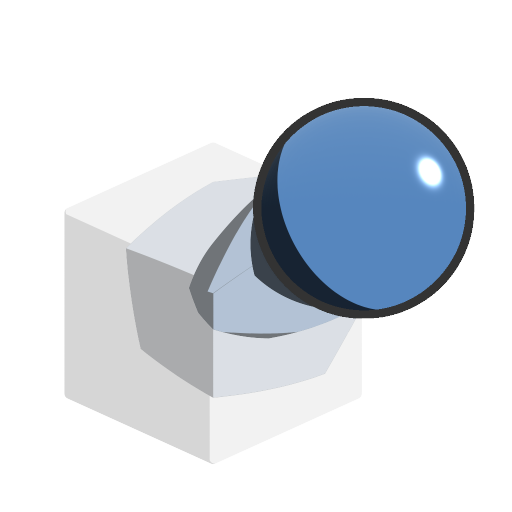

# モーフ

<table>
<tr style="border: 0;">
<td width="33.33%" style="border: 0;" valign="top">

<b>イン：</b> SDF 関数 >演算子

</td>
<td width="100.00%" style="border: 0;" valign="top">

## 説明

基本SDF形状と対象SDF形状のリニア補間を調整可能な混合係数に基づいて返します。

</td>
</tr>
</table>

>[!INFO]
> 
> SDF 関数に関する概念やワークフローについて詳しくは、専用ページ（[SDF 関数の操作](../../../../../../learning-tutorials/nodes/working-with-sdf-functions/working-with-sdf-functions.md)）を参照してください

## 入力

|  |  |
| :--- | :--- |
| <b>基本SDF</b> *浮動小数* | 基本SDFシェイプ。 |
| <b>ターゲットSDF</b> *浮動小数* | 対象のSDFシェイプ。 |
| <b>ミックス要素</b> *浮動小数* | 入力シェイプのモーフィングに使用するミックス係数。0は基本シェイプ、1はターゲットシェイプです。 |
