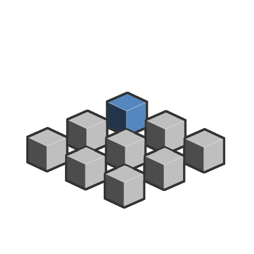

# ミラー範囲を繰り返す

<table>
<tr style="border: 0;">
<td width="33.33%" style="border: 0;" valign="top">

<b>イン：</b> SDF 関数 >演算子

</td>
<td width="100.00%" style="border: 0;" valign="top">

## 説明

SDFシェイプをX、Y、Zの正または負の軸に一定の間隔で何度もミラーおよび複製します。 この演算子は、図形を繰り返すたびに鏡像を作成します。 これにより、視覚的には、シェイプの元の方向と反転したコピーが交互になります。

</td>
</tr>
</table>

>[!INFO]
> 
> SDF 関数に関する概念やワークフローについて詳しくは、専用ページ（[SDF 関数の操作](../../working-with-sdf-functions.md)）を参照してください

## 入力

|  |  |
| :--- | :--- |
| <b>SDF</b> *浮動小数* | 入力されたSDFシェイプ。 |
| <b>金額+</b> *整数3* | 正のX、Y、Z軸に沿った複製量。  <i>既定： (2, 0, 0)</i> |
| <b>金額 – </b> *整数3* | 負のX、Y、Z軸に沿った複製量。  <i>既定： (2, 0, 0)</i> |
| <b>間隔</b> *浮動小数3* | 各複製間のワールド空間。  間隔は三次ヘルパーで表示されます。このサイズは、X、Y、Z方向の重複部分の間隔です。 間隔は<b>原点</b>から始まり、そこから対称に増加します。  <i>既定： (2, 2, 2)</i> |
| <b>元の位置</b> *浮動小数3* | 複製するSDFシェイプの中心を定義します。  原点は、三次ヘルパーの中心位置によって視覚化されます。  <i>既定： (0, 0, 0)</i> |
| <b>P</b> *浮動小数3* | ワールド空間の位置。 この入力を使用して、<b>Offset P</b>および<b>Rotate P</b>ノードを使用する他の変換を適用します。  <i>既定：変換されていないワールド空間の位置。</i> |
