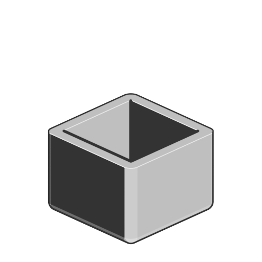

# シェル

<table>
<tr style="border: 0;">
<td width="33.33%" style="border: 0;" valign="top">

<b>イン：</b> SDF 関数 >演算子

</td>
<td width="100.00%" style="border: 0;" valign="top">

## 説明

作成されるエンベロープのThicknessを調整して、SDFシェイプを中空にします。

</td>
</tr>
</table>

>[!INFO]
> 
> SDF 関数に関する概念やワークフローについて詳しくは、専用ページ（[SDF 関数の操作](../../working-with-sdf-functions.md)）を参照してください

## 入力

|  |  |
| :--- | :--- |
| <b>SDF</b> *浮動小数* | 入力されたSDFシェイプ。 |
| <b>Thickness</b> *浮動小数* | シェルのThicknessは、内側と外側の両方に適用されます。 Thicknessを上げると、シェルが丸められます。  <i>既定値： 0.02</i> |
