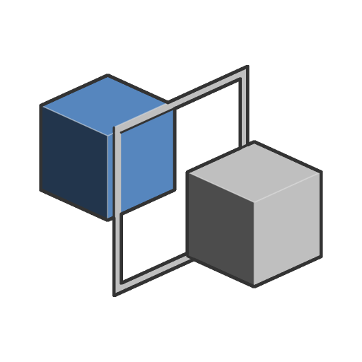

# 対称

<table>
<tr style="border: 0;">
<td width="33.33%" style="border: 0;" valign="top">

<b>イン：</b> SDF 関数 >演算子

</td>
<td width="100.00%" style="border: 0;" valign="top">

## 説明

対称面を横切るSDFシェイプをフリップして複製し、基本のSDFシェイプとその複製の和を返します。 対称は、すべての軸に同時に適用できます。

</td>
</tr>
</table>

>[!INFO]
> 
> SDF 関数に関する概念やワークフローについて詳しくは、専用ページ（[SDF 関数の操作](../../working-with-sdf-functions.md)）を参照してください

## 入力

|  |  |
| :--- | :--- |
| <b>SDF</b> *浮動小数* | 入力されたSDFシェイプ。 |
| <b>ミラー面の位置</b> *浮動小数3* | ミラー平面の中心のワールド空間位置。 対称が複数の軸に適用されている場合、この位置はすべてのミラー面で共有されます。  <i>既定： (0, 0, 0)</i> |
| <b>ミラー軸</b> *整数3* | 必要なミラー軸を設定します。  例： (1, 0, 0)は、X 軸に対称を適用します。  <i>既定： (1, 0, 0)</i> |
| <b>軸を反転</b> *整数3* | 反転する軸を設定します。  例： (1, 0, 0) X軸の対称方向を反転します。  <i>既定： (0, 0, 0)</i> |
| <b>事前オフセット</b> *浮動小数3* | 対称演算子を適用する前にシェイプに適用されるX、Y、Z軸上のオフセット。 |
