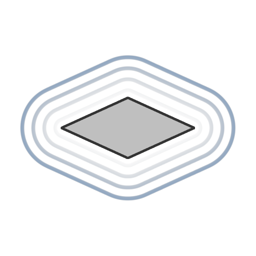

# 無限グリッド

<table>
<tr style="border: 0;">
<td width="33.33%" style="border: 0;" valign="top">

<b>イン：</b> SDF 関数 >プリミティブ

</td>
<td width="100.00%" style="border: 0;" valign="top">

## 説明

Heightを調整できる、無限のグリッドのSDF 関数です。

</td>
</tr>
</table>

>[!INFO]
> 
> SDF 関数に関する概念やワークフローについて詳しくは、専用ページ（[SDF 関数の操作](../../../../../../learning-tutorials/nodes/working-with-sdf-functions/working-with-sdf-functions.md)）を参照してください

## 入力

|  |  |
| :--- | :--- |
| <b>Height</b> *浮動小数* | 平面のZ-upHeight。  <i>既定値： 0</i> |
| <b>P</b> *浮動小数3* | ワールド空間の位置。 この入力を使用して、<b>Offset P</b>および<b>Rotate P</b>ノードを使用する他の変換を適用します。  <i>既定：変換されていないワールド空間の位置。</i> |
