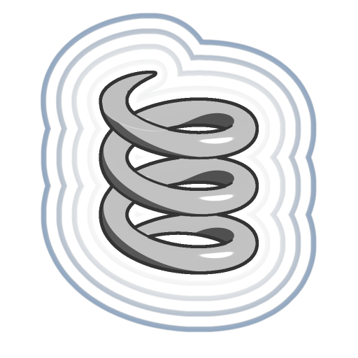

# らせん（約）

<table>
<tr style="border: 0;">
<td width="33.33%" style="border: 0;" valign="top">

<b>イン：</b> SDF 関数 >プリミティブ

</td>
<td width="100.00%" style="border: 0;" valign="top">

## 説明

ヘリックスの近似値のSDF 関数です。ヘリックスは、軸の上向きのカーブに沿って巻かれたカーブに沿って円をスイープすることによって形成されたシェイプです。  <i>注：</i>このSDF 関数は近似値なので、レンダリング時に斑点が表示される場合があります。

</td>
</tr>
</table>

>[!INFO]
> 
> SDF 関数に関する概念やワークフローについて詳しくは、専用ページ（[SDF 関数の操作](../../working-with-sdf-functions.md)）を参照してください

## 入力

|  |  |
| :--- | :--- |
| <b>主半径</b> *浮動小数* | 軸からの曲がり曲線の間隔です。  <i>既定値： 0.4</i> |
| <b>小半径</b> *浮動小数* | らせんのサーフェスを形成するために曲線に沿ってスイープされる円の半径。  <i>既定： 0.1</i> |
| <b>Height</b> *浮動小数* | らせんのZアップHeight。  <i>既定： 0.5</i> |
| <b>Windings</b> *浮動小数* | 0.5. ステップでカーブが軸の周りを完全に巻く回数、つまり、らせんが0.5のHeight内で回転する回数。  <i>既定値： 4</i> |
| <b>中央位置</b> *浮動小数3* | らせんの基点のワールド空間位置。  <i>既定値： (0, 0, 0)</i> |
| <b>P</b> *浮動小数3* | ワールド空間の位置。 この入力を使用して、<b>Offset P</b>および<b>Rotate P</b>ノードを使用する他の変換を適用します。  <i>既定：変換されていないワールド空間の位置。</i> |
