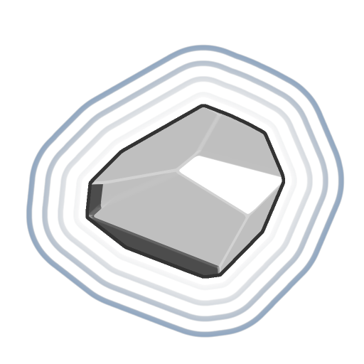

# ロック

<table>
<tr style="border: 0;">
<td width="33.33%" style="border: 0;" valign="top">

<b>イン：</b> SDF 関数 >プリミティブ

</td>
<td width="100.00%" style="border: 0;" valign="top">

## 説明

SDF 関数で構築された、パラメトリックでランダム化可能な岩形のSDF 関数。

</td>
</tr>
</table>

>[!INFO]
> 
> SDF 関数に関する概念やワークフローについて詳しくは、専用ページ（[SDF 関数の操作](../../working-with-sdf-functions.md)）を参照してください

## 入力

|  |  |
| :--- | :--- |
| <b>最大 ファセット</b> *整数* | 岩のファセットの最大数（最大32）。  <i>既定値： 8</i> |
| <b>Smoothness</b> *浮動小数* | 岩のエッジに適用される丸みを帯びた円弧の半径。  <i>既定： 0</i> |
| <b>ランダム度</b> *浮動小数* | 面の方向と中心からの距離をジッターします。 その結果、より大きな値を設定すると、岩が小さくなります。  <i>既定値： 0</i> |
| <b>シード</b> *浮動小数* | <b>ランダム度</b>パラメーターのシード。  <i>既定： 0</i> |
| <b>スケール</b> *浮動小数* | 岩のシェイプのグローバルスケール。 <b>ランダム度</b>の後、<b>Smoothness</b>の前に適用されました。  <i>既定： 0.5</i> |
| <b>中央位置</b> *浮動小数3* | 岩の基点のワールド空間位置。  <i>既定値： (0, 0, 0.5)</i> |
| <b>P</b> *浮動小数3* | ワールド空間の位置。 この入力を使用して、<b>Offset P</b>および<b>Rotate P</b>ノードを使用する他の変換を適用します。 <i>既定：変換されていないワールド空間の位置。</i> |
