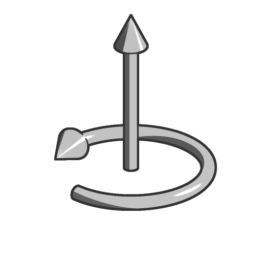

# 回転

<table>
<tr style="border: 0;">
<td width="33.33%" style="border: 0;" valign="top">

<b>イン：</b> SDF 関数 >変形

</td>
<td width="100.00%" style="border: 0;" valign="top">

## 説明

SDFシェイプを、調整可能な基点から1つまたは複数の軸を中心に回転させます。 <b>3Dビューアー</b>の<b>ピボットの変形</b> ヘルパーを使用して、実行された回転を表示します。

</td>
</tr>
</table>

>[!INFO]
> 
> SDF 関数に関する概念やワークフローについて詳しくは、専用ページ（[SDF 関数の操作](../../../../../../learning-tutorials/nodes/working-with-sdf-functions/working-with-sdf-functions.md)）を参照してください

## 入力

|  |  |
| :--- | :--- |
| <b>SDF</b> *浮動小数* | 入力されたSDFシェイプ。 |
| <b>角度</b> *浮動小数* | SDFシェイプを回転する角度。  <b>3Dビューアー</b>の<b>変形基点</b>ヘルパーの角度を円で表示します。 <b>軸</b>の矢印がこの円の中心になるようにカメラを合わせると、回転角度が回転の数分の1であることが明確になります。  <i>既定： 0</i> |
| <b>軸</b> *浮動小数3* | SDFシェイプを回転させる軸を定義する正規化されたベクトル。 例： (0, 1, 0)は、SDFシェイプをローカル基点のY軸を中心に回転させます。  <b>3Dビューアー</b>の<b>変形ピボット</b> ヘルパーの矢印で軸を表示します。 矢印の色は、このベクトルのXYZ成分にマップされます。  <i>既定： (0, 1, 0)</i> |
| <b>ピボットの位置</b> *浮動小数3* | SDFシェイプのローカル基点のワールド空間位置。(0, 0, 0)は、基点をSDFシェイプの中心に配置します。 回転の原点を定義します。  <b>3Dビューアー</b>の<b>ピボットの変形</b> ヘルパーにある矢印の始点に、ピボットが表示されます。 |
| <b>P</b> *浮動小数3* | ワールド空間の位置。 この入力を使用して、<b>Offset P</b>および<b>Rotate P</b>ノードを使用する他の変換を適用します。  <i>既定：変換されていないワールド空間の位置。</i> |
