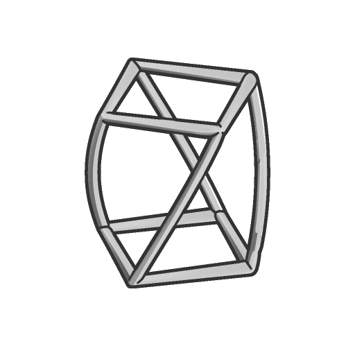

# ねじり（不正確）

<table>
<tr style="border: 0;">
<td width="33.33%" style="border: 0;" valign="top">

<b>イン：</b> SDF 関数 >変形

</td>
<td width="100.00%" style="border: 0;" valign="top">

## 説明

SDFシェイプのローカルZ軸に対する開始点と終了点の間の角度を調整できます。  <i>注：</i>この変換関数は厳密ではないため、レンダリング時に斑点が発生する可能性があります。

</td>
</tr>
</table>

>[!INFO]
> 
> SDF 関数に関する概念やワークフローについて詳しくは、専用ページ（[SDF 関数の操作](../../../../../../learning-tutorials/nodes/working-with-sdf-functions/working-with-sdf-functions.md)）を参照してください

## 入力

|  |  |
| :--- | :--- |
| <b>SDF</b> *浮動小数* | 入力されたSDFシェイプ。 |
| <b>角度</b> *浮動小数* | ツイストの終点に適用される回転の角度。 |
| <b>開始</b> *浮動小数* | ツイストが開始されるZ軸上のワールド位置です。 下のすべてのボリュームが歪んでいません。 |
| <b>終了</b> *浮動小数* | ツイストが終了するZ軸上のワールド位置です。 上のすべてのボリュームは、指定した角度で均等に回転されます。 |
| <b>P</b> *浮動小数3* | ワールド空間の位置。 この入力を使用して、<b>Offset P</b>および<b>Rotate P</b>ノードを使用する他の変換を適用します。  <i>既定：変換されていないワールド空間の位置。</i> |
