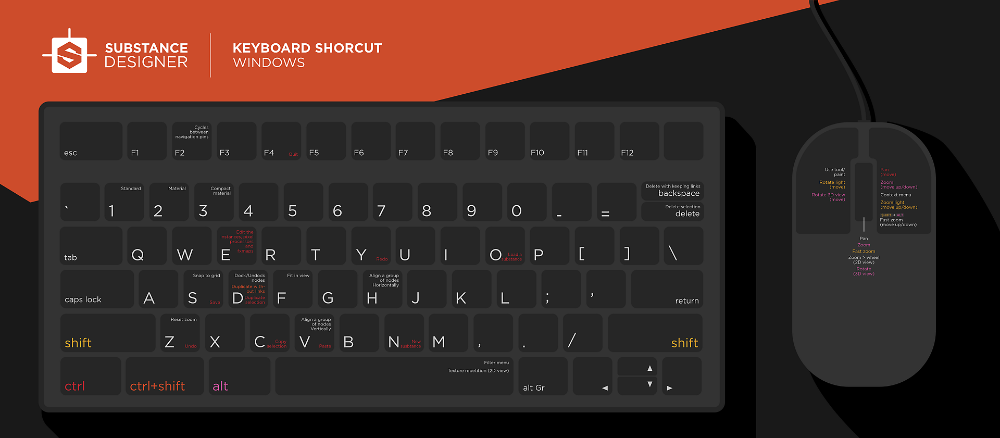

# ショートカット

このページでは、Substance 3D Designerのすべてのショートカットの概要を説明します。

## Keymaps

**ウィンドウ**

{zoomable="yes"}

**macOS**

{zoomable="yes"}

## ショートカットリスト

### グローバル

| アクション | Windows | macOS |
|:------------------------|:-------------|:-------------|
| 新規 Substance グラフ | Ctrl + N | ⌘ + N |
| パッケージを読み込み | Ctrl + O | ⌘ + O |
| パッケージを保存 | Ctrl + S | ⌘ + S |
| すべてのパッケージを保存 | Ctrl + ⇧ + S | ⌘ + ⇧ + S |
| 取り消し | Ctrl + Z | ⌘ + Z |
| やり直す | Ctrl + Y | ⌘ + Y |
| コンテキストメニュー | RMB | RMB |
| ドックを最大化 | ⇧ +スペースバー | ⇧ +スペースバー |
| エンジンを切り替え | F9 | F9 |
| エンジンを一時停止 | ⇧ + Escape | ⇧ + Escape |

{style="table-layout:fixed"}

### グラフビュー

**ビューポート**

| アクション | Windows | macOS |
|:----------------------|:---------------------------------------|:-------------------------------------|
| ズーム | マウスホイール Alt + RMBキーを押しながらドラッグ | MouseWheel ⌥ + RMBキーを押しながらドラッグ |
| 高速ズーム | ⇧ +マウスホイール ⇧ + Alt + RMB +ドラッグ | ⇧ +マウスホイール ⇧ + ⌥ +右マウスボタンを押しながらドラッグ |
| パン | MMB +ドラッグ Ctrl + RMB +ドラッグ | MMB +ドラッグ ⌘ + RMB +ドラッグ |
| ズームをリセット | Z | Z |
| ビューに合わせる | F | F |
| コピー | Ctrl + C | ⌘ + C |
| ペースト | Ctrl + V | ⌘ + V |
| 検索 | Ctrl + F | ⌘ + F |
| ノードメニュー | スペースバー | スペースバー |
| ナビゲーションピンを切り替え | F2 | F2 |

{style="table-layout:fixed"}

**選択範囲を作成しています**

| アクション | Windows | macOS |
|:--------------------------|:-------------------|:---------------|
| 「追加」を選択 | Ctrl + A | ⌘ + A |
| 選択状態を切り替え | Ctrl + LMB | ⌘ + LMB |
| 選択範囲の選択（追加） | Ctrl + LMBキーを押しながらドラッグ | ⌘ + LMB +ドラッグ |
| 選択範囲(減算) | Shift + LMB +ドラッグ | ⇧ + LMB +ドラッグ |

{style="table-layout:fixed"}

**選択したアイテム上**

| アクション | Windows | macOS |
|:------------------------------------|:-------------|:----------|
| 選択範囲をコピー | Ctrl + C | ⌘ + C |
| 選択範囲を複製 | Ctrl + D | ⌘ + D |
| リンクなしで複製 | Ctrl + ⇧ + D | ⌘ + ⇧ + D |
| 選択範囲を削除 | 削除 | 削除 |
| 選択範囲を削除してリンクを保持 | ⌫ | ⌫ |
| ノードのドッキング/ドッキング解除 | D | D |
| ビューに合わせる | F | F |
| 参照グラフを開く | ⌘ + E | ⌘ + C |
| ノードを水平方向に整列する | H | H |
| ノードを垂直方向に整列 | V | V |
| グリッドへのノードのスナップ | S | S |

{style="table-layout:fixed"}

**ノード接続**

| コネクターの訴え | Windows | macOS |
|:---------------------|:-----------|:--------|
| 接続を移動 | ⇧ + LMB | ⇧ + LMB |
| 同じソースから新規 | Ctrl + LMB | ⌘ + LMB |
| 接続を削除 | Alt + LMB | ⌥ + LMB |

{style="table-layout:fixed"}

| リンクに対するアクション | Windows | macOS |
|:---------------------------------|:----------|:--------|
| リンクを切り替える（一度に2つのリンク） | X | X |
| ドットノードを追加 | Alt + LMB | ⌥ + LMB |

{style="table-layout:fixed"}

#### グラフのみ

| アクション | Windows | macOS |
|:--------------------------------|:----------|:--------|
| 2D ビューのクイックビュー（ノード上） | Alt + LMB | ⌥ + LMB |
| ノードを無効にする | ⇧ + D | ⇧ + D |
| 書き出しグラフ出力 | Ctrl + B | ⌘ + B |
| ノードキャッシュをクリア | F5 | F5 |
| グラフレンダリングをキャンセル | エスケープ | エスケープ |

{style="table-layout:fixed"}

| リンク作成モード | Windows | macOS |
|:--------------------|:--------|:------|
| 標準 | 1 | 1 |
| マテリアル | 2 | 2 |
| コンパクトマテリアル | 3 | 3 |

{style="table-layout:fixed"}

>[!NOTE]
>
> このドキュメントの[このページ](../../interface/the-graph-view/link-creation-modes/link-creation-modes.md)のリンク作成モードについて説明します。

### 2D ビュー

| アクション | Windows | macOS |
|:---------------------|:---------------------------------------|:-------------------------------------|
| ズーム | マウスホイール Alt + RMBキーを押しながらドラッグ | MouseWheel ⌥ + RMBキーを押しながらドラッグ |
| 高速ズーム | ⇧ +マウスホイール ⇧ + Alt + RMB +ドラッグ | ⇧ +マウスホイール ⇧ + ⌥ +右マウスボタンを押しながらドラッグ |
| パン | MMB +ドラッグ Ctrl + RMB +ドラッグ | MMB +ドラッグ ⌘ + RMB +ドラッグ |
| 100%にリセット | Z | Z |
| ビューに合わせる | F | F |
| タイル表示の切り替え | スペースバー | スペースバー |

{style="table-layout:fixed"}

### 3D ビュー

| アクション | Windows | macOS |
|:-----------------------------------------------------|:--------------------------------|:-----------------------------|
| ドリーカメラ（前方/後方パン） | マウスホイール Alt + RMBキーを押しながらドラッグ | MouseWheel ⌥ + RMBキーを押しながらドラッグ |
| 軌道周回カメラ | LMBキーを押しながらドラッグ | LMBキーを押しながらドラッグ |
| トラックとペデスタルのカメラ（横型および縦型パン） | MMB +ドラッグ Ctrl + RMB +ドラッグ | MMB +ドラッグ ⌘ + RMB +ドラッグ |
| 環境を回転 | Ctrl + ⇧ + RMB | Ctrl + ⇧ + RMB |
| 一時的にポイントライト1のコントロールに切り替える | ⇧ （保留） | ⇧ （保留） |
| オービットポイントライト1 | LMBキーを押しながらドラッグ | LMBキーを押しながらドラッグ |
| ドリーポイントライト1 | RMB +ドラッグ | RMB +ドラッグ |
| レンダリングを保存 | Alt + S | ⌥ + S |
| レンダリングをクリップボードにコピー | Alt + C | ⌥ + C |
| カメラの位置をリセット | R | R |
| カメラの状態をリセット | ⇧ + R | ⇧ + R |
| メッシュを選択（ラスタライザーとGPU パストレーサーのみ） | ⇧ + LMB | ⇧ + LMB |
| フレーム選択 | F | F |

{style="table-layout:fixed"}

### エクスプローラー

| アクション | Windows | macOS |
|:----------------------------------|:----------|:-------|
| 選択したパッケージを閉じる | Ctrl + F4 | ⌘ + W |
| パッケージ/リソースを再読み込み | Ctrl + R | ⌘ + R |
| リソース名を変更 | F2 | F2 |
| リソースの削除 | 削除 | 削除 |
| エディター/ビューアでリソースを読み込む | Enter | Enter |
| 選択したパッケージをSBSARにPublish | Ctrl + P | ⌘ + P |

{style="table-layout:fixed"}
