# 3D ビュー

3D ビューは、カスタムメッシュとレンダリングされたPBRマテリアルを使用してマテリアルを表示および理解するのに役立ちます。 すべてのSubstance 3D Designerウィンドウと同様に、右クリックメニューオプションおよびドラッグアンドドロップ操作を使用して他のウィンドウと連携します。

3Dビューには、3D シーンでマテリアルをレンダリングする方法として、主に次の2つがあります。
* **ラスタライザー**&#x200B;と&#x200B;**OpenGL**&#x200B;のレンダラーを使用した、高速なリアルタイムの視覚化
* **GPU パストレーサー**&#x200B;レンダラーを使用した高品質のレイトレースレンダリング

詳細については、こちらを参照してください： [3Dレンダラー](3d-renderers/3d-renderers.md)

+++ 3Dビューのドック

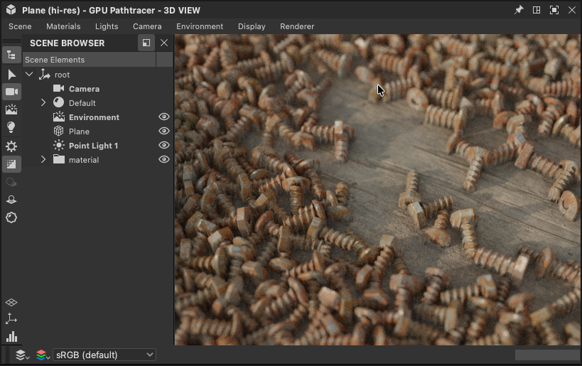

+++

## ビューポート相互作用

以下のセクションでは、一般的なアクションを簡単に実行する方法と、そのプロセスを説明するアニメーションGIFについて説明します。

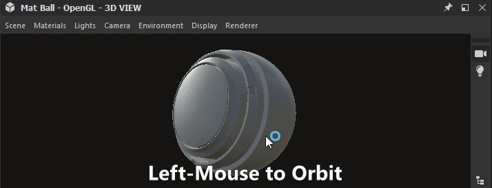

### ナビゲーション

カメラと環境は、次の3つの方法で操作できます。

* <b>軌道：</b> LMB +ドラッグ
* <b>パン</b>: MMB+ドラッグ/ Ctrl+RMB+ドラッグ
* <b>ズーム</b>:マウスホイールを使用してスクロールする/RMB+ドラッグ
* <b>環境の回転：</b> ⇧+右マウスボタンを押しながらドラッグ
* <b>選択したメッシュにフォーカス：</b>F （選択がない場合はシーン全体にフォーカス）
* <b>オービットポイントライト1:</b> Ctrl + ⇧ + LMB +ドラッグ
* <b>ポイントライト1を原点に近づける、または原点から遠ざける：</b> Ctrl+⇧+RMB+ドラッグ
* <b>カメラオービットの位置をリセット：</b> R
* <b>カメラオービットの位置とプロパティをリセットします：</b> ⇧+R

トラックパッドの使用（macOSのみ）

* <b>オービット：</b> 2本指でのスワイプ
* <b>パン:</b> ⇧+2本指でスワイプ
* <b>ズーム： </b>2本指ピンチ/ ⌘+2本指スワイプ
* <b>環境の回転：</b> ⇧+2本指でスワイプ

>[!NOTE]
>
> ズーム方向
> 
> 各ズーム方法は、他の方法と反転する：
> 
> * マウスホイールを&#x200B;*上げるとシーンが近づく*
> * 元のサイズでシーンを&#x200B;*プッシュ*&#x200B;し、上にドラッグします
> 
> ズーム方向は、[環境設定](../../interface/preferences-window/preferences-window.md)で反転できます。

### 選択してフォーカス

ビューポートでメッシュを直接操作できます。

<b>メッシュの⇧を押しながらLMBをクリックして、メッシュを選択します。</b> 選択したメッシュには青い輪郭が表示されます。

<b>選択したメッシュにフォーカスするには、Fキーを押します</b>。 メッシュに焦点を合わせると、カメラがフレームに動き、その周りを公転します。

<b>メッシュが選択されている間にRMBをクリックすると</b>、コンテキストメニューで[マテリアルアクション](#material-actions)にアクセスできます。

<b>Escキーを押して選択を解除します。</b> カーソルはメッシュ上にある必要はありません。

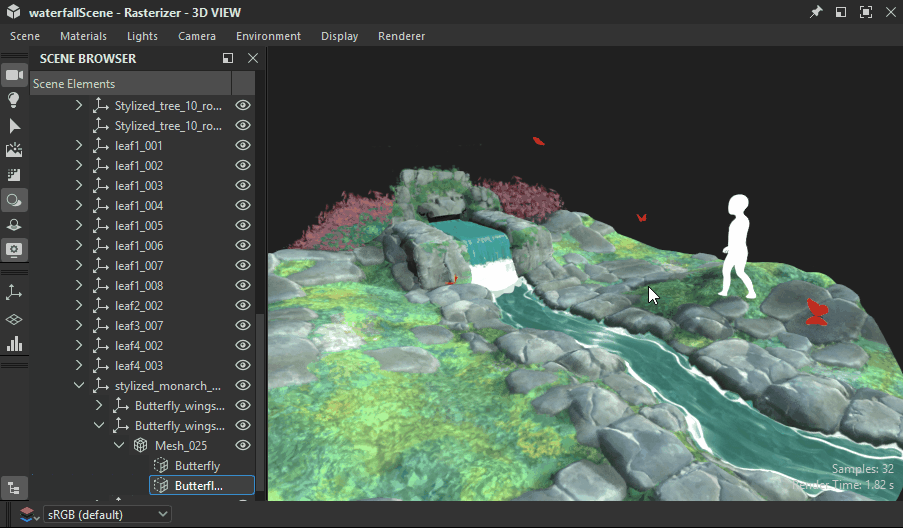{zoomable="yes"}

*選択、フォーカス、選択解除*

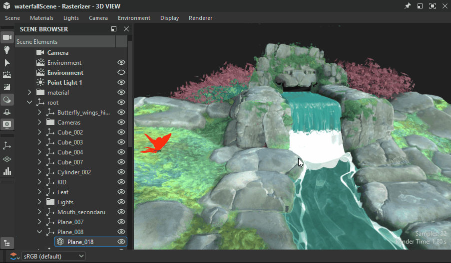{zoomable="yes"}

*選択、コンテキストメニュー*

>[!NOTE]
>
> これらのアクションは、非推奨の[OpenGL](../../interface/3d-view/3d-renderers/3d-renderers.md)レンダラーでは使用できません。

### 環境照明(IBL)を変更する

Designerは、デフォルトで画像ベースの照明(IBL)で動作します。 ハイダイナミックレンジビットマップは、環境照明のレンダリングに使用されます。

この環境は、3Dオブジェクトを中心に回転できます。また、プリセットまたはカスタムHDRライトの環境を読み込むこともできます。 HDR画像では、正距円筒図法の投影を使用し、32 bit浮動小数点の精度を設定する必要があることに注意してください。

3Dビューで、⇧ + RMBキーを押しながら<b>ドラッグすると、環境が回転します</b>。

正確な回転角度を設定するには、上部の3D ビューツールバーの<b>Environment > Edit</b>を使用し、プロパティウィンドウの<b>回転角度</b>スライダーを変更します。

プリセットのHDR光環境を使用するには、[ライブラリ](../../interface/the-library/the-library.md)の<b>3D ビューカテゴリ</b>の<b> HDRI環境</b>セクションをクリックし、いずれかのアイコンを3Dビューにドラッグ&amp;ドロップします。

独自のカスタムHDRライトエクスプローラーを使用するには、環境ウィンドウのパッケージにファイルをドラッグ&amp;ドロップして、HDRイメージをインポートします（プロンプトが表示されたらファイルを<b>リンク</b>）。 次に、リソースをドラッグ&amp;ドロップし、ターゲットとして<b>緯度/緯度パノラマ</b>を選択します。

### 点光源

<b>ライト/プロパティを編集</b>に移動して、シーンのポイントライトを切り替えます。

Point Light 1は、LMBまたはRMBを押したままビューポートのライトモードでドラッグすることで、シーンの原点を中心に動かすことができます。 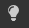

カメラモードの場合 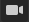、Ctrl + ⇧キーをマウスボタンと組み合わせて押すことにより、一時的に照明モードに切り替えることもできます。

## 3D ビュー内のデータを表示する

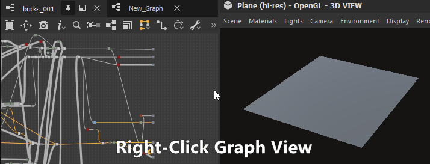

### Substance グラフ

マテリアル全体を3D ビュー内の完全なマテリアルとして表示できます。 これは最も一般的な操作方法であり、出力ノードの[使用属性](../../compositing-graphs/nodes-reference-for-com/atomic-nodes/output/output.md)は3Dビューマテリアルの関連するテクスチャスロットと一致します。 つまり、出力を正しく設定する必要があり（テンプレートを使用することで可能になります）、選択したマテリアル / ビューポートシェーダーが

グラフのすべての出力を表示するには、[グラフビュー](../../interface/the-graph-view/the-graph-view.md)で&#x200B;*元*&#x200B;の空の領域をクリックし、コンテキストメニューの&#x200B;**3D ビューの出力を表示**&#x200B;オプションを選択します。

[エクスプローラー](../the-explorer-window/the-explorer-window.md)ドックのグラフリソースで「人民元」をクリックし、コンテキストメニューの&#x200B;**「3D ビューの出力を表示」**&#x200B;オプションを選択すると、グラフの出力を開かずに表示することもできます。

グラフのコンテキストメニューの代わりに、グラフを[エクスプローラー](../the-explorer-window/the-explorer-window.md)ドックから3D ビューにドラッグして、同じ結果を得ることができます。

*グラフを読み込み中*&#x200B;は、既定で出力が3D ビューに自動的に適用されます。 この動作は、[環境設定](../../interface/preferences-window/preferences-window.md)で無効にできます。 **編集/環境設定/グラフ/共通**&#x200B;に移動し、「**グラフーを開くときに3Dビューで出力を表示**」オプションをオフにします。

>[!NOTE]
>
> **複数のマテリアルスロット**
> 
> 複数のマテリアルでカスタムメッシュを使用する場合は、マテリアルを割り当てるマテリアルスロットを選択するように求められます。 上記のいずれかの方法で、スロットをクリックして選択を確定します。 マテリアルとその課題について詳しくは、以下の詳細セクションを参照してください。

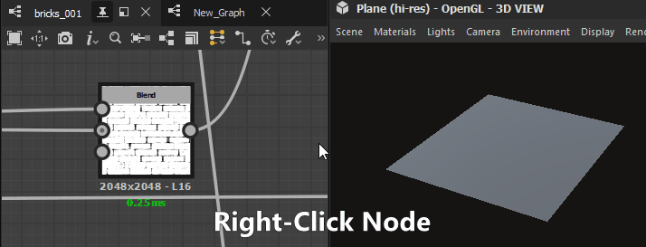

### 個々のノード/グラフ出力

[3D ビュー](https://substance3d.adobe.com/)の使用可能なマテリアルチャンネルで、1つの出力のみを表示できます。 この方法はあまり一般的には使用されませんが、出力のない簡単なテストや個々のノードをプレビューするのに適しています。

[グラフビュー](../../interface/the-graph-view/the-graph-view.md)でノードを右クリックし、[<b>3D ビューで表示</b>]を選択すると、出力ノードだけでなく、任意のノードを表示できます。 ノードを割り当てる使用可能なチャンネルのリストが表示されます。 「任意」をクリックして確定します。

また、*RMB*&#x200B;を使用して、グラフビューから3D ビューにノードをドラッグアンドドロップすることもできます。 ノードを割り当てる使用可能なチャンネルのリストが表示されます。 「任意」をクリックして確定します。

[エクスプローラー](../the-explorer-window/the-explorer-window.md)ドックでグラフグラフ出力を展開し、*LMB*&#x200B;を使用して出力を3D ビューにドラッグすると、任意のリソースを表示できます。 ノードを割り当てる使用可能なチャンネルのリストが表示されます。 「任意」をクリックして確定します。

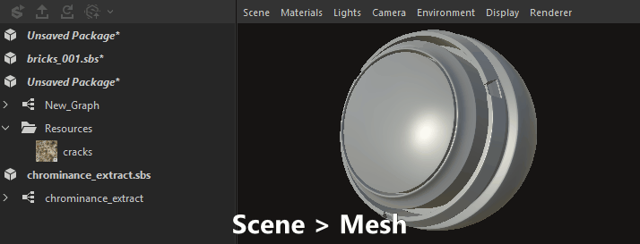

## （カスタム）3D シーンの表示

Designerには、多数のプリセットメッシュがあります。 これらのメッシュは、均一で使用可能なUV座標を備えており、タイリングテクスチャのほとんどのシナリオに使用できます。 独自の3D メッシュの読み込みと表示も可能です。\
トップバーの<b>シーン</b>ドロップダウンメニューからデフォルトのメッシュのいずれかを選択します。

カスタム3D シーンの場合は、[「3D シーンの操作」](../../learning-tutorials/3d-view/working-with-3d-scenes/working-with-3d-scenes.md)セクションに移動します。

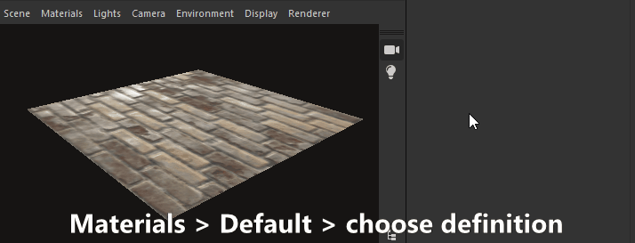

## シェーダープロパティの変更

Designerでは、デフォルトでいくつかの[シェーダ](../../learning-tutorials/essentials/glossary/glossary.md#shader)を使用できます。各シェーダーには、テクスチャチャンネル以外のオプションがあります。 これらは個別に設定できます。

Designerの[3Dレンダラー](../../interface/3d-view/3d-renderers/3d-renderers.md)間でシェーダーが異なり、「共通」ラベルが付いた設定のみがレンダラーの切り替え時に引き継がれます。

現在のシェーダーを変更するには、**マテリアル**&#x200B;メニューに移動し、編集するマテリアルのサブメニューを開きます。

例えば、&#39;平面（高解像度）&#39; シーンの&#39;`Default`&#39; マテリアルのマテリアルプロパティを調整するには、**マテリアル/既定/プロパティの編集**&#x200B;に移動します。 次に、プロパティドックでマテリアルプロパティを見つけます。

シェーダは、サブメニューの「マテリアルをリセット」または「シーンステートにリセット」アクションを使用してリセットできます。 3Dビューでグラフ出力を表示していた場合、再度適用する必要があります。

>[!NOTE]
>
> **テセレーションについて**
> 
> メッシュのテセレーションは、[ディスプレイスメントポップアップ](displacement/displacement.md#tessellation)の&#x200B;**テセレーション率**&#x200B;パラメーターを使用して調整できます。
> このパラメーターで制御される特定のプロパティは、現在の3Dレンダラーによって異なります。
> 
> * **ラスタライザー/GPU パストレーサー:** **レベルの調整**&#x200B;という名前のオブジェクト単位のプロパティ。 `Mesh`オブジェクトを[シーンブラウザー](scene-browser/scene-browser.md)で選択して、プロパティを表示し、直接編集します。
> * **OpenGL:** **テセレーション係数**&#x200B;という名前のマテリアルごとのプロパティ。 [マテリアルのプロパティ](#change-shader-properties)に移動して、直接編集します。

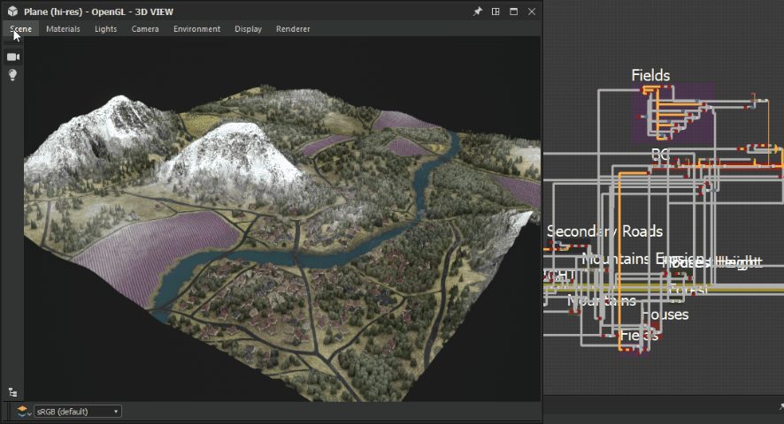

## シーンを書き出し

[このページ](../../learning-tutorials/3d-view/working-with-3d-scenes/exporting-scenes/exporting-scenes.md)の3D シーンの書き出しについて説明します。

### テッセレーションされたメッシュの書き出し（OpenGLレンダラーのみ）

メッシュを<b>3D ビュー</b>から<b>OBJ</b>、<b>FBX</b>または<b>PLY</b>形式のファイルにエクスポートできます。 *テセレーション*&#x200B;ディスプレイスメントが有効な場合、ジオメトリのサブディビジョンがエクスポートされたメッシュにベイクされます。

ただし、元のメッシュの頂点法線が新しいディスプレイスされたシェイプと一致しない場合があり、ディスプレイスされたメッシュが正しくレンダリングされないことがあります。 次の2つの方法で管理できます。

* 正しい法線を提供するメッシュ *法線マップ*&#x200B;を使用してください
* *メッシュ法線マップを使用して書き出し時にメッシュ法線を再計算*&#x200B;します。つまり、これらの法線は書き出されたメッシュにベイクされ、法線マップは不要になります

メッシュを書き出すには、<b>シーン/テッセレーションされたメッシュを書き出し…</b>に移動し、法線の再計算に関する選択を行い、書き出すメッシュの場所、名前、およびファイルフォーマットを選択します。

>[!NOTE]
>
> この機能は、**macOS**&#x200B;では&#x200B;*利用できません*&#x200B;です。

>[!IMPORTANT]
>
> いくつか注意事項
> 
> 元のメッシュに複数のマテリアルやUV セットがある場合、これらは&#x200B;*1つに結合*&#x200B;されます。
> 
> 書き出しプロセスの期間と結果のファイルサイズは、三角形のメッシュ数と&#x200B;*テセレーション率*&#x200B;によって異なります。 テセレーション率の値が高いと、GPUのオンボードメモリプールによっては不安定になる可能性があります。
> 
> つまり、テッセレーションされたメッシュの頂点数は、*Height*&#x200B;マップのピクセル数と&#x200B;*同じ範囲*&#x200B;にある必要があります。
> 
> <b>Phong</b> メッシュを使用する場合は、高さマップよりも高密度のテセレーションを使用するとメッシュが少しスムーズになりますが、最初に必要なソフトウェアの詳細を含んだメッシュが確実に書き出されるように注意し、必要に応じて他の高さマップで書き出されたメッシュを調整する必要があります。

>[!WARNING]
>
> **TDR （Windowsのみ）**
> 
> この機能を使用するには、Designerの[技術要件](../../getting-started/system-requirements/system-requirements.md)で説明されているように、<b>タイムアウトの検出と回復(TDR)</b>がドキュメントの[このページ](https://experienceleague.adobe.com/en/docs/substance-3d-painter/using/technical-support/technical-issues/gpu-issues/gpu-drivers-crash-with-long-computations-tdr-crash)の推奨値と一致している必要があります。

## メニューバー

メニューバーには、3D ビューに関するオプションを含む7つのメニューが表示されます。 以下に、使用可能なすべてのオプションの概要を示します。

+++シーン
<b>シーン</b>メニューは、表示されているジオメトリ（3Dリソース）と3Dビューの状態を扱います。 3Dリソースは単なるメッシュであり、シーンのステートはライト、カメラ、および関連する設定であり、メッシュをそれに沿って含めることもできます。

![[シーン]メニューのメッシュ](3d-view.resources/3d-view-meshes.png "[シーン]メニューのメッシュ")

<b>編集： </b>[プロパティ](../../interface/properties/properties.md)パネルのシーンオプションを読み込みます。 3D メッシュの表示/非表示を切り替えることができます。

<b>標準プリミティブ：</b> 3D ビュー内の以下の単純な3D メッシュを表示します。

* 立方体

* 円柱

* 白抜きボックス

* インナーボックス

* 平面

* 平面 (高解像度)

* 球面

<b>拡張プリミティブ：</b> 3D ビュー内の以下の3Dメッシュを表示します。

* 布

* マットボール

* 角丸立方体

* 角丸円柱

* 球面 2 タイル

* トーラス

<b>2D ビューのUVを表示：</b>現在選択されているメッシュのUVを[2D ビュー](../2d-view/2d-view.md)にオーバーレイとして表示します。

<b>現在のシーンから3Dリソースを作成…:</b>現在のシーンからパッケージ内に新しい[3D シーンリソース](../../resources/3d-scene-resource/3d-scene-resource.md)を作成します。

<b>状態ファイルを読み込む…: </b>外部に保存された[シーン状態ファイル](../../learning-tutorials/3d-view/working-with-3d-scenes/working-with-3d-scenes.md) (\*.sbsscn)を読み込みます。 3D メッシュは置き換えられず、3Dレンダラー、カメラ、ライトの設定のみが読み込まれます。

<b>メッシュを含む状態ファイルを読み込む…:</b>外部に保存された[シーン状態ファイル](../../learning-tutorials/3d-view/working-with-3d-scenes/working-with-3d-scenes.md) (\*.sbscn)を読み込みます。 3Dレンダラー、カメラ、ライトとその参照3D シーンの設定をロードします。 .

<b>状態ファイルを保存する…: </b>3Dビューの現在の状態を[シーン状態ファイル](../../learning-tutorials/3d-view/working-with-3d-scenes/working-with-3d-scenes.md) (\*.sbscn)に保存します。

<b>現在の状態を既定として保存： </b>新しい3Dビューを作成するときに既定で使用される3Dビューの現在の状態を[シーンの状態ファイル](../../learning-tutorials/3d-view/working-with-3d-scenes/working-with-3d-scenes.md)として設定します。 このファイルは、3Dビューがリセットまたは初期化されるたびに読み込まれ、[プロジェクト設定](../../interface/preferences-window/project-settings/project-settings.md)で設定できます。

<b>シーンのエクスポート：</b> *（ラスタライザー/GPU パストレーサーレンダラーのみ）*&#x200B;現在のシーンを[統合されたシーン](../../learning-tutorials/3d-view/working-with-3d-scenes/exporting-scenes/exporting-scenes.md)として書き出します。この場合、結果のシーンのみが書き込まれ、元のシーンへの参照はすべて失われます。 書き出されるシーンの内容は、選択した書き出し形式でサポートされる機能によって異なります。\
利用可能な形式：STL、FBX、GLB、GLTF、PLY、USDC、USD、USDA、USDZ、OBJ。

<b>レイヤーを含んだシーンの書き出し：</b> *（ラスタライザーおよびGPU パストレーサーレンダラーのみ）*現在のシーンを[レイヤーシーン](../../learning-tutorials/3d-view/working-with-3d-scenes/exporting-scenes/exporting-scenes.md)として書き出します。元のシーンへのすべての編集内容は、非破壊的なワークフローで個別のファイルに保存されます。 これは、USDファイル形式の場合にのみ使用できます。\
利用可能な形式は、USDC、USD、USDAです。

<b>テッセレーションされたジオメトリのエクスポート：</b> *（OpenGLレンダラーのみ）*&#x200B;現在のシーンをテセレーション付きでRAWジオメトリとしてエクスポートします。「シーンのエクスポート」セクションを参照してください。

<b>シーンのリセット： </b>3Dビューを既定の状態にリセットします。

ソフトウェアのアップデートによっては、シーンのステートファイルの保存や読み込み方法が変わる場合があります。

シーンがファイルから&#x200B;*正しく復元*&#x200B;されない場合は、手動でシーンの必要な状態を設定し、シーンの状態ファイルを&#x200B;*再度書き出し*&#x200B;することをお勧めします。

+++

+++マテリアル
<b>マテリアル</b>メニューは、読み込まれた3D メッシュと使用されているレンダラーに基づいて変化します。

「マテリアル」メニューには、シーンのメッシュに割り当てられたすべてのマテリアルのリストが表示されます。 「マテリアル」メニューに表示される各マテリアルには、マテリアル操作のサブメニューがあります。

<b>編集</b> – プロパティウィンドウで現在のマテリアルの設定を編集します。

<b>シェーダーリスト</b> – 現在の[3Dレンダラー](../../interface/3d-view/3d-renderers/3d-renderers.md)で使用できるすべての[シェーダー](../../learning-tutorials/essentials/glossary/glossary.md#shader)。

<b>定義の読み込み…: </b> （OpenGLレンダラーのみ）独自のカスタム[GLSLFX シェーダーを読み込むことができます。](../../interface/3d-view/glslfx-shaders/glslfx-shaders.md) シェーダーが上のリストに追加されます。

<b>共通パラメータのリセット：</b>シェーダ間で共通するすべてのパラメータをリセットします。 例えば、ラスタライザー/GPU パストレーサーレンダラーとOpenGLレンダラーを切り替える場合、[Adobe Standard Material](https://experienceleague.adobe.com/en/docs/substance-3d/general-knowledge/asm/adobe-standard-material)のいくつかのパラメーター値が引き継がれます。

<b>名前の変更：</b>このマテリアルのラベルを変更します。

<b>マテリアルのリセット：</b>すべてのシェーダーパラメーターを既定値にリセットします。 テクスチャがシェーダーのサンプラーのいずれかに接続されている場合は、接続が解除されます。

<b>マテリアルをシーンの状態にリセットします： </b>*（ラスタライザまたはGPU パストレーサーレンダラーのみ）* [上書きされたマテリアル](../../learning-tutorials/3d-view/working-with-3d-scenes/overriding-scene-materials/overriding-scene-materials.md)のすべてのプロパティを、シーンから元の値にリセットします（元のテクスチャがある場合はリセットします）。

<b>追加： </b>新しいマテリアルを一覧に追加します。 既定では使用されず、[シーンブラウザー](../../interface/3d-view/scene-browser/scene-browser.md)を使用して[シーン マテリアルに接続](../../learning-tutorials/3d-view/working-with-3d-scenes/overriding-scene-materials/overriding-scene-materials.md)されている可能性があります。

+++

+++ライト
<b>ライト</b>メニューは、従来の環境光と点光源のみを扱います。 これらのライトはPBRに準拠しておらず、HDRのイメージベースのレンダリングと同じ高品質の結果が得られません。

<b>編集：</b>環境光と2つの点光源の個別の設定を編集します。

<b>光源のリセット：</b>ライトのプロパティを既定の状態にリセットします。

+++

+++カメラ
<b>カメラ</b>メニューを使用すると、カメラの設定を変更したり、定義済みの角度に移動したり、カスタム3D メッシュファイル内に格納されているカメラ角度を読み込んだりできます。

<b>プロパティの編集：</b>既定のカメラの設定をプロパティドックで開きます。

<b>フォーカス： </b> (F)現在選択されているメッシュに既定のカメラを適用します。 つまり、メッシュにフレームを付け、カメラピボットをそのエレメントに合わせます。 アクティブな選択範囲がない場合は、シーンのグローバルバウンディングボックスが使用されます。

<b>シーンのカメラ:</b>シーンに1つ以上のカメラが含まれている場合、それらの設定がここに一覧表示され、シーンの既定のカメラに適用されるプリセットとして使用されます。

<b>ビューポイント：</b>既定のカメラの事前設定されたPOV。 これは、カメラのトランスフォーム（位置と回転）にのみ影響します。

* デフォルト：オブジェクトの前方左から撮影した高角度のショット。

* 戻る

* 下

* フロント

* 左

* 右

* 上

<b>レンダリングを保存…:</b> (Alt + S)現在レンダリングされているイメージをディスクに保存します。ディスクの解像度は、レンダラーのプロパティで指定されている解像度に設定するか、既定のカメラーのプロパティで上書き解像度が設定されている場合に指定されます。

<b>クリップボードにレンダリングをコピー：</b> (Alt+C)現在レンダリングされているイメージをクリップボードにコピーし、外部イメージエディターで貼り付けます。

<b>位置のリセット：</b> (R) カメラの位置をリセットします。

<b>選択した項目のリセット：</b> (Shift + R) カメラの位置とプロパティをリセットします。

+++

+++環境
<b>環境</b>メニューを使用すると、PBR正しいマテリアルに照明を当てるために使用されるHDRI環境に関連する設定を変更できます。

<b>プロパティの編集：</b> PBRの照明に使用されるHDR環境設定へのアクセスを許可します。 具体的には、表示の切り替え、プレビューを使用した露出の変更、正確なスライダーを使用した回転の設定ができます。

<b>環境のリセット：</b>すべての環境プロパティを既定にリセットします。

+++

+++表示
[表示]メニューでは、レンダリングされたシーンの表示モード、ヘルパー、情報を切り替えることができます。

<b>軸:</b> ビューポートの3D 軸の表示を切り替えます。

<b>グリッド:</b>ワールドフライの表示を切り替えます。

<b>解像度：</b>小さい解像度のカウンターの表示を切り替えます。

<b>シーンの統計情報：</b>ポリカウント、マテリアル数、静的メッシュ数などのシーン統計情報の表示を切り替えます。

<b>レンダリング時間：</b>画像全体に対して1つのサンプルを計算する時間。

<b>サンプル：</b>アキュムレーションアンチエイリアシング（ラスタライザ）またはパストレース（GPUパストレーサ）用に計算されたピクセルサンプルの量です。

<b>バックフェースカリング:</b>このオプションを無効にすると、*両側*&#x200B;からメッシュ面が表示されます。 このオプションはワイヤーフレームと組み合わせて使用できます

<b>バウンディングボックス：</b> メッシュのバウンディングボックスの表示を切り替えます。

<b>ワイヤーフレーム:</b>メッシュワイヤーフレームの表示を切り替えます。

<b>光源：</b>点光源のヘルパー線の表示を切り替えます。

<b>正接空間：</b>すべての頂点の正接、従法線、および法線ベクトルを色付きギズモとして表示します

これらのオプションの一部は、シーンツールバーでボタンを切り替えると使用できるようになります。

+++

+++レンダラー
<b>レンダラー</b>メニューでは、3Dレンダラーを切り替えたり、<b>プロパティの編集</b>アクションを使用して現在の3Dレンダラーのプロパティにアクセスしたりできます。

使用可能なレンダラーとその設定については、[この専用ページ](../../interface/3d-view/3d-renderers/3d-renderers.md)で説明しています。

+++

## シーンツールバー

**シーン**&#x200B;ツールバーは、既定では3D ビューの左側の境界に配置され、シーンを表示して操作するためのコントロールを提供します。

また、[ディスプレイスメントポップアップ](displacement/displacement.md)と[シーンブラウザー](scene-browser/scene-browser.md) Dockにアクセスすることもできます。

>[!NOTE]
>
> ツールバーは、3本の並行線で表される左端の&#x200B;*ハンドル*&#x200B;を使用して、**3D ビュー**&#x200B;のドックの周りに&#x200B;*再配置*&#x200B;できます。

### 表示オプション

#### 上

 

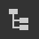 <b>シーンブラウザー</b>

3D シーン内のすべての要素の階層を表示します。

>[!INFO]
>
>シーンブラウザーとその機能については、[専用ページ](../../interface/3d-view/scene-browser/scene-browser.md)で詳しく説明しています。

 <b>選択</b>

シーン内のメッシュを直接選択できます。

<code>LMB</code> シーンでメッシュを選択します。

シーン内の個々のメッシュを選択します。 選択したメッシュはビューポート内で青いアウトラインになり、[シーン一覧](../../interface/3d-view/scene-browser/scene-browser.md)で強調表示されます。

選択したメッシュに対してコンテキストメニューを利用できます。<code>RMBをクリックすると表示される場合があります</code>.

メッシュは、<code>Shift + LMBキーを押して、カメラモードまたはライトモードでも選択できます</code>.

 

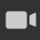 <b>カメラ</b>

シーン内のカメラを直接制御できます。

<code>LMB</code> カメラをターゲットの周りに回します。 <code>RMB</code> カメラを移動先に近づけたり、移動先から離したりします。

 

 <b>環境の表示</b>

このボタンをクリックすると、シーンの環境の表示が切り替わります。 同じ設定は、3D ビューのメニューバーの<b>環境/編集</b>に移動した後、プロパティドックで見つけることができます。

 

 <b>明</b>

シーン内の点光源1を直接制御できます。

<code>LMB</code> シーンの原点を中心にカメラを回ります。 <code>RMB</code> ライトをシーンの原点に近づけたり、原点から遠ざけたりします。

 

 <b>レンダラー設定</b>

現在のレンダラーの設定を[プロパティ](../properties/properties.md)ドックに表示します。

 

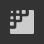 <b>パストレーサを有効にする</b>

[GPU パストレーサー](3d-renderers/3d-renderers.md#gpu-pathtracer)レンダラーの選択を切り替えます。

 

 <b>シャドウを有効にする</b>

[ラスタライザ](3d-renderers/3d-renderers.md#rasterizer)レンダラーのリアルタイムシャドウのレンダリングを切り替えます。

 

 <b>グリッドを有効にする</b>

[ラスタライザ](3d-renderers/3d-renderers.md#rasterizer)および[GPU パストレーサー](3d-renderers/3d-renderers.md#gpu-pathtracer)のレンダラーでグリッドのレンダリングを切り替えます。

 

 <b>ディスプレイスメント</b>

[ディスプレイスメントポップアップ](displacement/displacement.md)を表示します。

 

#### 下

 

 <b>グリッド</b>

ワールドグリッドの表示を切り替えます。

 

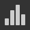 <b>シーンの統計情報</b>

Polycount、マテリアル数、静的メッシュ数などのシーン統計情報の表示を切り替えます。

 

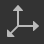 <b>軸</b>

ビューポートでの3D 軸の表示を切り替えます。

 

#### OpenGLレンダラーのみ

 

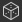 <b>バックフェースカリング</b>

このオプションを無効にすると、*両側*&#x200B;からの面が表示されます。 このオプションは、ワイヤーフレームと組み合わせて使用できます。

 

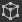 <b>バウンディングボックス</b>

メッシュのバウンディングボックスの表示を切り替えます。

 

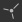 <b>頂点 正接領域</b>

すべての頂点の正接、従法線、法線ベクトルを色付きギズモとして表示します。

 

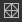 <b>ワイヤーフレーム</b>

メッシュのワイヤーフレーム表示を切り替えます。

## ツールバーを表示

<b>ディスプレイ</b>ツールバーは、既定では<b>3D ビュー</b>パネルの&#x200B;*下部*&#x200B;にあり、ビューポートでのレンダリングイメージの表示方法を制御できます。

>[!NOTE]
>
> ツールバーは、3本の並行線で表される左端の&#x200B;*ハンドル*&#x200B;を使用して、**3D ビュー**&#x200B;のドックの周りに&#x200B;*再配置*&#x200B;できます。

### 3D レンダリング AOV

<table style="margin-top: 32px; margin-bottom: 32px">
    <tr style="border: 0; vertical-align: top">
        <td style="border: 0">
            
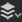 <b>3DレンダリングAOV</b>ボタンを使用して、異なる<a href="../../glossary/glossary.md#aov">AOV</a>を表示できます。

            
AOVを使用すると、メッシュ情報とマテリアル情報を個別に検査して、集中的な作業とデバッグを行うことができます。

            
一部のAOVには、ビューポートで1 （純白）または0 （純黒）にクランプされる<i>HDR 値</i>が含まれています。 すべての値を確認するには、AOVの3Dレンダリングを、<code>.exr</code>などのHDR 値をサポートするイメージファイル形式にエクスポートします。 現在のAOVをエクスポートするには、[<code>Camera > Save render...</code>]メニューオプションを使用します。

            
<i>注意：</i> AOVは、ラスタライザーとGPU パストレーサー <a href="./3d-renderers/3d-renderers.md">3Dレンダラー</a>を使用している場合にのみ使用できます。

        </td>
        <td style="width: 33%; border: 0">
            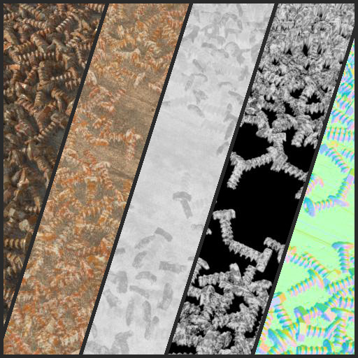
        </td>
    </tr>
</table>

### カラーチャンネル

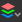 <b>カラーチャンネル</b>ボタンを使用して、画像のシングルチャンネルを表示できます。 これによりコンボボックスが開き、<b>赤</b>、<b>緑</b>および<b>青</b>のチャンネルのうち、表示するチャンネルを選択できます。 <b>[RGB]</b>を選択すると、すべてのチャンネルを含む画像の通常の状態が復元されます。

<b>カラーチャンネル</b>ボタン&#x200B;*の*&#x200B;アイコン&#x200B;*は、現在表示されているチャンネルによって異なります*。

### カラースペース

色を最も正確に表現するために、既定で画像は、*モニター*&#x200B;で使用されているものと一致する&#x200B;*カラースペース*&#x200B;に表示されます。

使用できるコントロールは、[プロジェクト設定](../../interface/preferences-window/project-settings/project-settings.md)で設定されたカラーマネジメントモードによって異なります。 これらのコントロールについて詳しくは、このページの「[カラーマネジメント](../../color-management/color-management.md)」セクションを参照してください。
