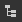
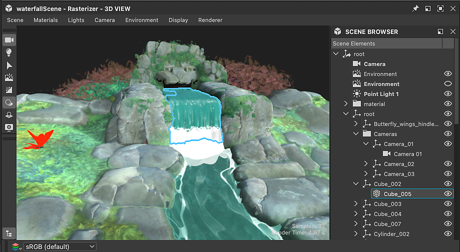
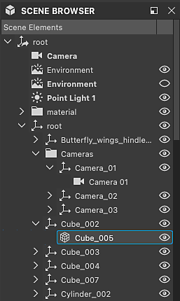
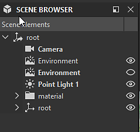
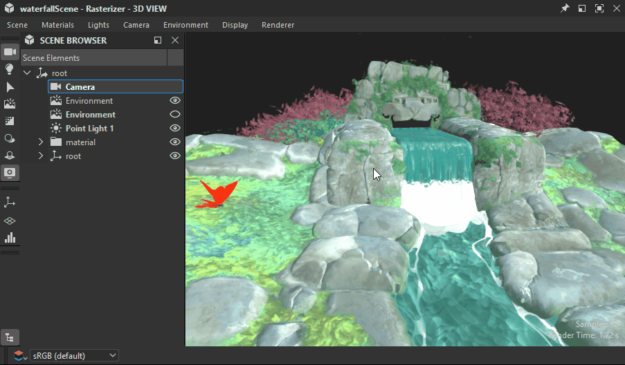
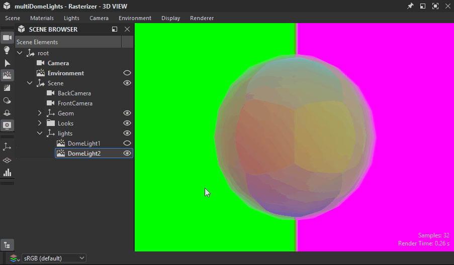
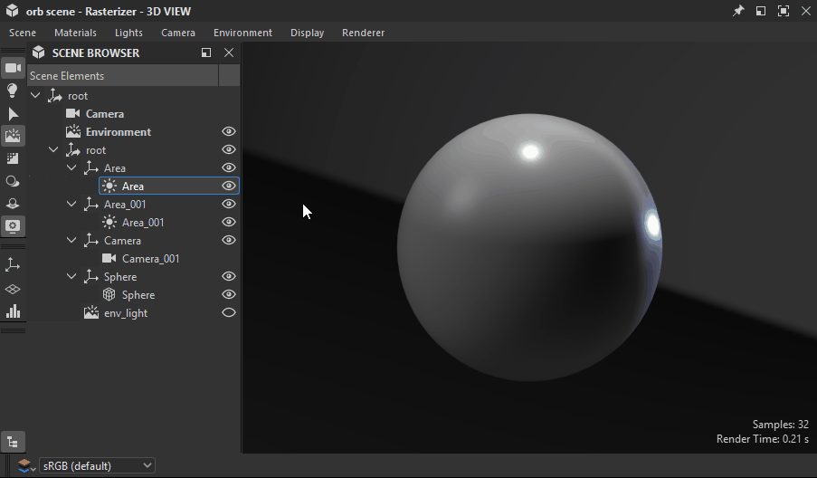
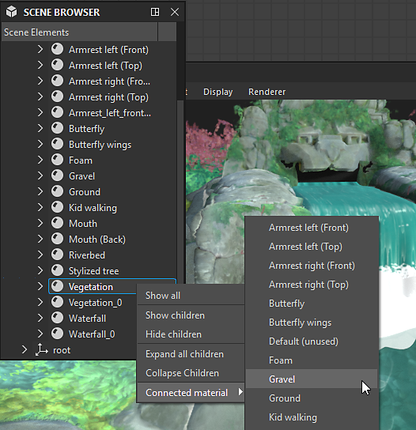

# シーンブラウザー

3Dビューのシーンブラウザには、シーン内のすべての要素とその階層が一覧表示されます。

オブジェクトの選択、表示/非表示の切り替え、[シーンのマテリアルを上書きする](../../../learning-tutorials/3d-view/working-with-3d-scenes/overriding-scene-materials/overriding-scene-materials.md)必要があるマテリアルの選択を行うためのコントロールを提供します。

Designerでは、シーンの説明と管理に[USD](https://openusd.org/release/index.html)を使用しているため、用語とコンセプトはそのシーンツリーにあります。

これは、[3Dビューのシーンツールバー](../../../interface/3d-view/3d-view.md)で専用のトグルボタンをクリックすると表示されます。

{zoomable="yes"}

## シーンツリー

<table>
<tr style="border: 0;">
<td width="100.00%" style="border: 0;" valign="top">

シーンブラウザには、階層ツリーに配置されたオブジェクトのリストが表示されます。

オブジェクトは、シーンのルートまで、他のオブジェクトの親になります。 親オブジェクトには、子のリストを展開または折りたたむために使用する矢印ボタンがあります。

一部のオブジェクトには、選択時に[プロパティ](../../../interface/properties/properties.md)ドックで表示および編集できるプロパティがあります：環境、カメラ、ライト、`Mesh`オブジェクトおよびマテリアル[オーバーライド](../../../learning-tutorials/3d-view/working-with-3d-scenes/overriding-scene-materials/overriding-scene-materials.md)。

</td>
<td width="33.33%" style="border: 0;" valign="top">

{zoomable="yes"}

</td>
</tr>
</table>

ツリー内の任意の項目にカーソルを置いたまま数秒間待つと、ツールチップに次の情報が表示されます。

* <b>Path:</b> シーン内のオブジェクトの完全なパスです。
* <b>TypeName:</b>オブジェクトのUSD型です。
* <b>ドキュメント：</b> USD シーン要素としてのオブジェクトに関する詳細情報です。

メッシュには、頂点数、面数、UV数などの詳細情報が表示されます。

### Designerで追加されたオブジェクト

<table>
<tr style="border: 0;">
<td width="100.00%" style="border: 0;" valign="top">

Designerは、読み込まれた任意のシーンにオブジェクトを追加します。 Designerによって追加されたオブジェクトには、<b>太字</b>でラベルが付けられます。

「ライト」、「カメラ」、「環境」の各メニューで「編集…」アクションを使用すると、シーン内に他のライト、カメラ、環境があるかどうかに関係なく、これらのオブジェクトが編集されます。

これらのオブジェクトは、[書き出し](../../../learning-tutorials/3d-view/working-with-3d-scenes/exporting-scenes/exporting-scenes.md)時にシーンに含められます。

</td>
<td width="33.33%" style="border: 0;" valign="top">

{zoomable="yes"}

</td>
</tr>
</table>

* <b>カメラ:</b> シーンの既定のカメラです。 Designerでやり取りできるカメラはこれだけです。 読み込まれたシーンに含まれているカメラは、デフォルトカメラのプリセットとして追加されます。
* <b>Environment:</b> シーンの既定のEnvironmentです。 シーンの環境に適用されるテクスチャは、その環境にのみ適用されます。 同様に、環境の回転はその環境にのみ影響します。\
  読み込まれたシーンに1つ以上の環境光（USDの[DomeLight](https://openusd.org/release/user_guides/schemas/usdLux/DomeLight.html)）が含まれている場合は、シーンの環境光を妨げないように初期設定の環境が自動的に無効になります。
* <b>ポイントライト#:</b>ライト/プロパティの編集でDesignerのポイントライトのいずれかが有効になっている場合は、各ポイントライトがシーンに追加されます。

## シーン内のオブジェクトの切り替え

### すべてのタイプ

シーンでは、任意のオブジェクトを有効または無効にできます。 無効にすると、オブジェクトはシーンに影響しなくなります。シャドウをキャストしたり、光を放出したり、反射したりすることはありません。

親オブジェクトの状態はその子に継承されるので、親オブジェクトを無効にすると、その子も無効になります。

オブジェクトの表示/非表示は、目のボタンをクリックするか、コンテキストメニューから切り替えることができます。 メニューには、シーンオブジェクトの表示を管理するためのアクションがいくつか用意されています。

* <b>非表示：</b>選択したオブジェクトを無効にします。
* <b>表示：</b>選択したオブジェクトを有効にします。

メッシュの表示に特に影響を与えるアクションがいくつかあります。

* <b>表示のみ：</b>選択した項目とその子を除くすべてのメッシュを無効にします。
* <b>すべて表示：</b>すべてのメッシュを有効にします。

親オブジェクトには、次のような追加のアクションがあります。

* <b>子を非表示：</b>選択したオブジェクトのすべての子を再帰的に無効にします。
* <b>子の表示：</b>選択したオブジェクトのすべての子を再帰的に有効にします。
* <b>すべての子を展開：</b>選択したオブジェクトの下にあるすべての子のリストを再帰的に展開します。
* <b>すべての子を折りたたむ：</b>選択したオブジェクトの下にあるすべての子のリストを再帰的に折りたたみます。

{zoomable="yes"}

### 環境

環境光(DomeLight)の表示/非表示は、他のオブジェクトと同様に有効/無効にできます。

環境光を無効にすると、シーンに対する光源の役割も無効になります。

複数の環境光が有効になっている場合、照明の効果は&#x200B;*累積的に追加*&#x200B;されます。

{zoomable="yes"}

### ライト

シーン内の任意のライトでも同じことが言えます。各ライトは個別に切り替えることができます。

{zoomable="yes"}

## 接続されたマテリアル

シーンブラウザーを使用すると、オーバーライドされたマテリアルを、3Dビューの[マテリアルメニュー](../../../interface/3d-view/3d-view.md)にDesignerによってリストされた別のマテリアルに接続することもできます。

<table>
<tr style="border: 0;">
<td style="border: 0;" valign="top">

Designerで一覧表示されるマテリアルは、シーンツリー内のマテリアルオブジェクトであり、少なくとも1つのメッシュで使用されます。

これらのマテリアルのいずれかを[上書き](../../../learning-tutorials/3d-view/working-with-3d-scenes/overriding-scene-materials/overriding-scene-materials.md)すると、コピーがDesignerによって作成され、数値の接尾辞が付きます。

オーバーライドされたマテリアルは、コンテキストメニューに別の項目を表示します。&#39;[接続されたマテリアル](../../../learning-tutorials/3d-view/working-with-3d-scenes/overriding-scene-materials/overriding-scene-materials.md)&#39;サブメニューには、このマテリアルをオーバーライドするために使用できるその他のすべての利用可能なマテリアルが一覧表示されます。

</td>
<td style="border: 0;" valign="top">

{zoomable="yes"}

</td>
</tr>
</table>
