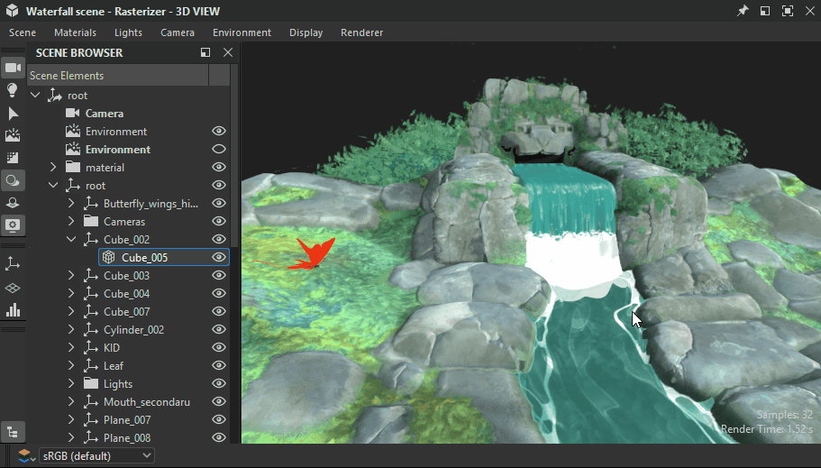
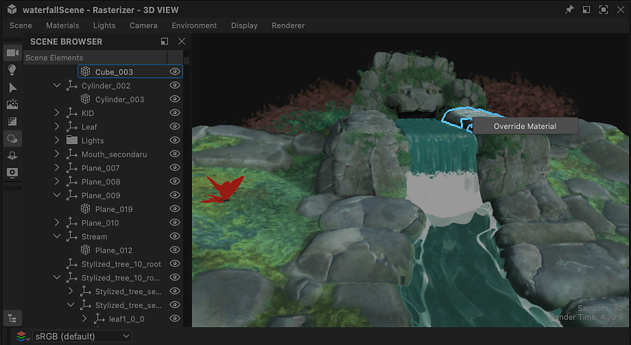
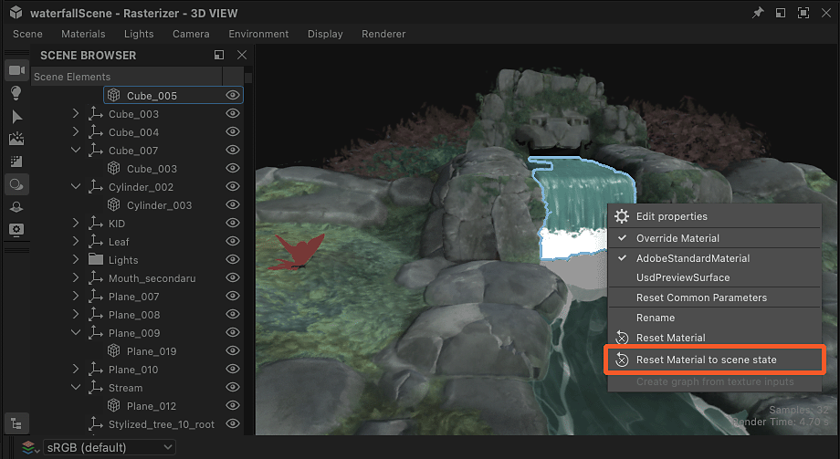
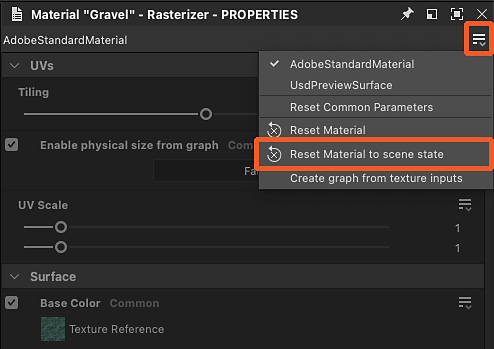
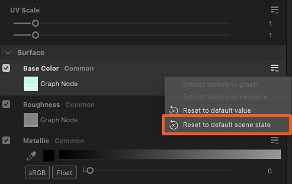
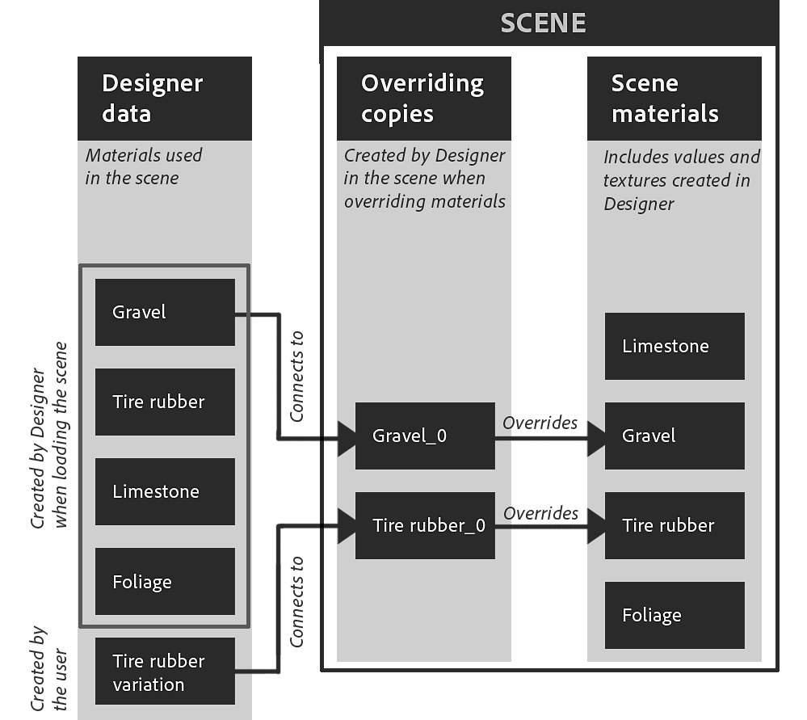
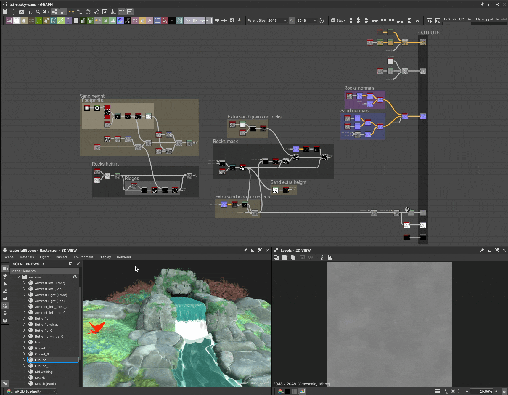

# マテリアルの上書き

既存のマテリアルで3D シーンを操作する場合、これらのマテリアルを上書きして独自の要素に置き換える必要があります。

マテリアルをゼロから作成することも、[Substanceのグラフに抽出](../extracting-materials/extracting-materials.md)されたシーンのマテリアルの調整後のバージョンを作成することもできます。

{zoomable="yes"}

## マテリアルを上書き

シーンで使用されているマテリアルは、新しいバージョンまたは編集された既存のマテリアルの独自のマテリアルで上書きできます。

「マテリアルを上書き」アクションは、次の2つの場所にあります。

* マテリアルメニューを開き、目的のマテリアルのサブメニューに移動します
* シーンオブジェクトでShift + LMBを押して選択し、 RMBをクリックしてコンテキストメニューを開きます

<table>
<tr style="border: 0;">
<td style="border: 0;" valign="top">

{zoomable="yes"}

*3D ビュー ビューポートの操作*

</td>
<td style="border: 0;" valign="top">

![[マテリアルの上書き] - [マテリアル]メニューでの操作](overriding-scene-materials.resources/overrideMaterialActionMaterials.png "[マテリアルの上書き] - [マテリアル]メニューでの操作"){zoomable="yes"}

*マテリアルメニューの操作*

</td>
</tr>
</table>

Designerでは、内部シーンの説明にUSDが使用されます。オーバーライドとは、可能な限りオリジナルと一致するマテリアルのコピーを&#x200B;*作成*&#x200B;し、シーンのメッシュの&#x200B;*マテリアルバインディング*&#x200B;をオリジナルからコピーに変えることです。

>[!NOTE]
>
> コピーは、ルートの下の&#39;<b>マテリアル</b>&#39; シーンー（ USDの&#39;Scope&#39;）にフォルダー内に作成され、元のフォルダーと同じ識別子に数値のサフィックス（例： &#39;rustedMetal\_0&#39;）を使用します

これは、次の2つの重要な点を意味します。

1. 元のマテリアルは一切変更されません。
2. Designerで行った作業はすべてコピーに適用されます。

元のシーンのマテリアルを元に戻す場合、または行く途中で簡単な編集前後のチェックを行う場合は、同じ「マテリアルのオーバーライド」操作を使用して、任意の時点でオーバーライドのオン/オフを切り替えることができます

コピーがオリジナルと一致するように作成されることを考えると、ほとんどの場合、マテリアルをオーバーライドしても、Substanceグラフをリンクするか、そのプロパティを編集するまで、外観は変わりません（以下の注を参照）。

>[!NOTE]
>
> オーバーライドが適用されると、Designerは影響を受けるメッシュの正接と従法線を計算します。これには時間がかかり、特にメッシュに法線のスケールとバイアスが定義されていない場合、または別のメッシュを使用する場合に、動作が変わります。

>[!IMPORTANT]
>
> <b>AdobeStandardMaterial</b>のシェーディングモデルはSubstance 3Dエコシステム全体でサポートされていますが、業界標準ではないため、Blenderなどのサードパーティ製アプリケーションでは&#x200B;*サポートされない場合があります*。
> 
> Substance 3Dアプリケーションの外部で最高の相互運用性を実現するために、シェーディングのプロパティや効果のサポート対象が大幅に少ない場合でも、<b>UsdPreviewSurface</b>マテリアルモデルの使用をお勧めします。

## シーンの状態にリセット

上書きされた状態を維持したままマテリアルの初期状態に戻す必要がある場合は、マテリアルコピーを初期値にリセットできます。

マテリアルプロパティ値が変更された場合、またはグラフからのテクスチャが適用された場合、プロパティは初期値またはテクスチャに戻ります。

マテリアルは、完全に、またはプロパティごとにリセットできます。

マテリアルのサブメニューまたはメッシュのコンテキストメニューの「マテリアルをシーンステートにリセット」アクションを使用すると、マテリアルを完全にリセットできます。

アクションは、次の3つの場所で見つけることができます。

* マテリアルメニューを開き、目的のマテリアルのサブメニューに移動します
* シーンオブジェクトでShift + LMBを押して選択し、 RMBをクリックしてコンテキストメニューを開きます
* マテリアルプロパティの上部にあるハンバーガーメニュー

<table>
<tr style="border: 0;">
<td style="border: 0;" valign="top">

{zoomable="yes"}

*3D ビュー ビューポートの操作*

</td>
<td style="border: 0;" valign="top">

![マテリアルをシーンの状態にリセットする – [マテリアル]メニューの動作](overriding-scene-materials.resources/resetMaterialToSceneStateActionMaterials.png "マテリアルをシーンの状態にリセットする – [マテリアル]メニューの動作"){zoomable="yes"}

*マテリアルメニューの操作*

</td>
<td style="border: 0;" valign="top">

{zoomable="yes"}

*マテリアルのプロパティの操作*

</td>
</tr>
</table>

<table>
<tr style="border: 0;">
<td style="border: 0;" valign="top">

マテリアルの一部の部分のみをリセットする場合に備えて、マテリアルのプロパティで&#x200B;*プロパティ単位*&#x200B;のアクションも使用できます。

マテリアルプロパティのハンバーガーメニューを開き、「デフォルトのシーンステートにリセット」アクションを見つけます。

</td>
<td style="border: 0;" valign="top">

{zoomable="yes"}

</td>
</tr>
</table>

## 接続されたマテリアル

繰り返しますが、Designerはシーンのマテリアルを直接変更するのではなく、シーンにコピーを作成し、メッシュを元のコピーではなく、そのコピーにバインドします。

一方、Designerの「マテリアル」メニューには、*独自*&#x200B;のマテリアルのリストがあり、デフォルトではシーンのマテリアルのリストと一致します。 このリストには、いつでも新しいマテリアルを追加できます。

これは、Designerのみで作成および管理される&#x200B;*別*&#x200B;データセットです。 これらのマテリアルは、シーンの元のマテリアルを上書きする&#x200B;*コピー*&#x200B;に接続されます。

{zoomable="yes"}

シーンブラウザーでDesignerによって作成されたコピーに、「マテリアル」メニューに表示されているいずれかのマテリアルを接続できます。シーンーでコピーに対して「RMB」をクリックし、「接続マテリアル」サブメニューを開きます。

サブメニューには、シーン内のすべてのマテリアルと、「マテリアル」メニューから手動で作成したマテリアルが一覧表示されます。

{zoomable="yes"}
