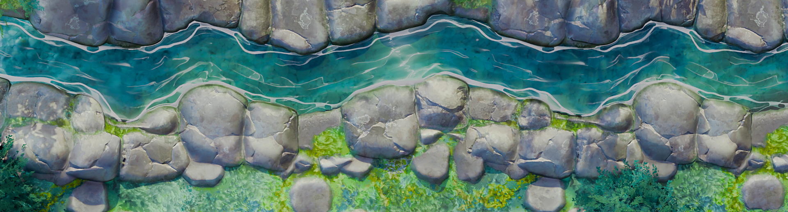
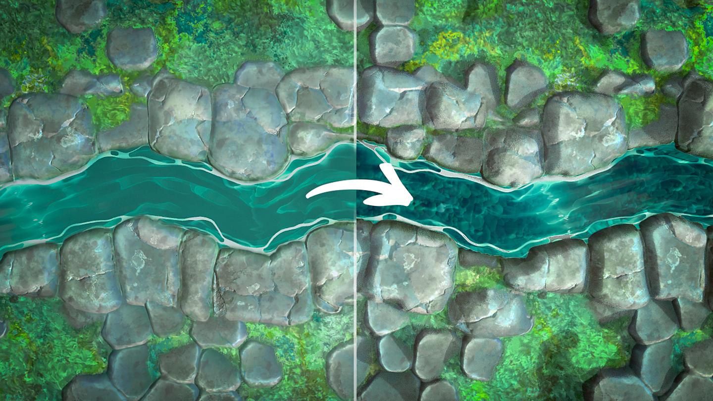
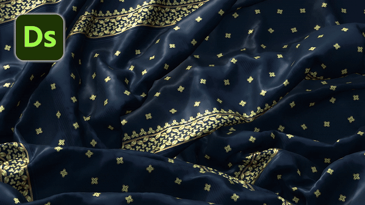
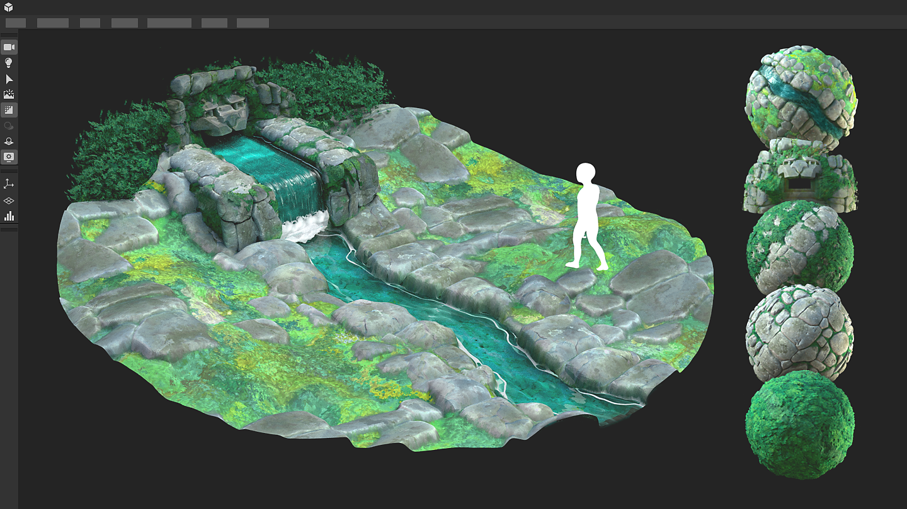
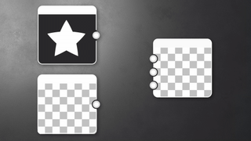
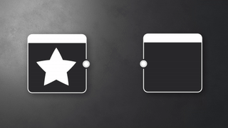
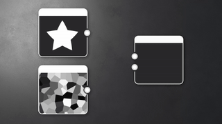
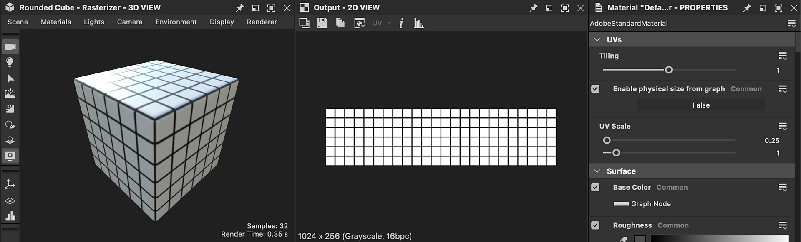
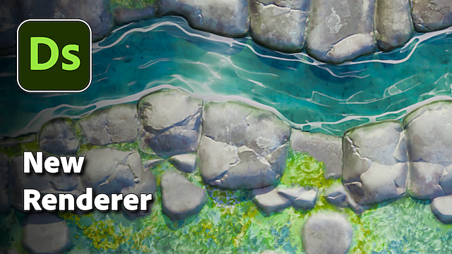

# バージョン15.0

このアップデートでは、ラスタライザーモードとパストレーサーモードを備えた新しい3dレンダラーに加え、[USD](https://openusd.org/release/index.html)のネイティブサポートが提供されるため、データを失うことなくシーンの編集や書き出しを行うことができます。

*リリース日：2025年7月15日*

## 新しい 3D レンダラー

### 新しいラスタライザとパストレーサ

この新しいリリースでは、ラスタライザーモード（マテリアルの作業中にリアルタイムのプレビューを表示）とパストレーサーモード（完全で正確なレンダリングを行うレイトレースモード）を備えた高度な[3Dレンダラー](../../interface/3d-view/3d-renderers/3d-renderers.md)にアクセスできます。 この新しいレンダラーは、ラスタライザーモードでのシャドウなどの機能を使用して機能を強化し、品質とパフォーマンスを向上させます。また、[MaterialX](https://materialx.org/)などの将来のテクノロジーをサポートするように設計されています。 Designerの既存のOpenGLおよびIrayレンダラーを補完し、Substance 3D ViewerおよびSubstance 3D Samplerで利用できるレンダラーと連携して、エコシステム全体で統一されたエクスペリエンスを実現します。

[3dビューツールバー](../../interface/3d-view/3d-view.md)が更新され、このレンダラーで使用できる新機能の一部にすばやくアクセスできるようになりました。

* <b>選択ツール:</b>を使用して、シーン内のサブメッシュを選択します。 サブメッシュを選択したら、そのサブメッシュにフォーカスするか(F)、サブメッシュのマテリアルプロパティにアクセスします（右クリック）。
* <b>パストレーサを有効にする：</b>を選択すると、パストレーサモードとラスタライザモードをすばやく切り替えることができます。
* <b>シャドウを有効にする：</b>シーンのシャドウを有効にします。マテリアルが光に従ってどのように動作するかを確認するのに便利です。
* <b>グリッドを有効にする：</b> シーンのグリッドを有効にするか無効にします。

さらに、環境光を回転させるホットキーが他のSubstanceアプリと一致するように変更されたため、*<b>Ctrl + Shift + Rightをクリック</b>*&#x200B;する代わりに&#x200B;*<b>Shift + Rightをクリック</b>*&#x200B;するようになりました。

### ポストエフェクト

[ポストエフェクトが戻りました](../../interface/3d-view/camera/post-effects/post-effects.md)! 現在はカメラメニューから入手でき、社内で開発されています。

* <b>ブルーム:</b>光や反射などの明るい部分の周囲のグレアをシミュレートして、emissiveの表面をより正確に視覚化します。
* <b>トーンマッピング： </b>広ダイナミックレンジ(HDR)効果を得るためのプロファイルを持つ色範囲。
* <b>フィールドの深度:</b>は、カメラレンズのフォーカスプロパティをシミュレートします（ラスタライザのみ）。

の投稿FX

## コンテキスト内のアセットエディション

マテリアルで作業する場合は、[特定の3D シーンのコンテキストでプレビュー](../../working-with-3d-scenes/working-with-3d-scenes.md)します。 そのため、すべてのテクスチャ、カメラ、ライトを含むフルシーンを読み込んでレンダリングできるようになりました。 チェリーの上に表示されます。このシーンがMaterialXシェーダを参照している場合は、ラスタライザを使用して正しくレンダリングされます。

読み込みが完了すると、メッシュを選択して（Shiftキーを押しながらクリックするか、シーンブラウザーのおかげで）、[そのマテリアルを上書き](../../working-with-3d-scenes/overriding-scene-mat/overriding-scene-materials.md)することで、シーンを操作できます。 その後、次の操作を実行できます。

* グラフを作成または読み込み、シーンマテリアルに適用します。
* 既存のマテリアルを調整するには、[そのテクスチャを抽出](../../working-with-3d-scenes/extracting-materials-val/extracting-materials-values-and-textures.md)して新しいグラフにします。

最後に、3d シーンを編集したら、[書き出し](../../working-with-3d-scenes/exporting-scenes/exporting-scenes.md)して、新しいファイルまたは元のファイルの新しいレイヤーとして保存し、データの損失を防ぎます（USDフォーマットの場合のみ）。

最後に大切なことですが、USD(+ usda、usdc、usdz)、STL、PLY、GLTFに加え、FBXとOBJなど、読み込みと書き出しの両方でサポートされる3d形式が増えています。

## 詳細ツールチップ

各ノードの目的をより明確に示すために、詳細ツールチップが導入されました。 これらのツールヒントは、現在、[ノード](../../compositing-graphs/nodes-reference-for-com/atomic-nodes/atomic-nodes.md)のみで使用可能です。アトミックノードの効果を示すビジュアルを含み、パラメーター、ヒント、コツなどの一覧の詳細についてはドキュメントへの直接リンクを提供します。

<table>
<tr style="border: 0;">
<td style="border: 0;" valign="top">

</td>
<td style="border: 0;" valign="top">

</td>
<td style="border: 0;" valign="top">

</td>
</tr>
</table>

## 非正方形のサポートの改善

非正方形テクスチャを使用する必要がある場合は、この新しいオプションが適しています。 3Dビューの[マテリアルプロパティ](../../interface/3d-view/material-properties/material-properties.md)で、タイリングを制御するUVオプションで、両方の軸に異なる値を設定できるようになりました。

{zoomable="yes"}

## ベイカー

ベイクインターフェイスでのマイナーな更新はわずかですが（詳しくは以下の詳細リストを参照）、ベイカーライブラリはGPUベースのベイカーを使用するために完全に再構築され、パフォーマンスが大幅に向上しています。 このアップデートは、上記の新しくサポートされたファイル形式に加え、ベイクワークフローに従事するユーザーの大幅な向上を示します。

注意： sbsbaker.exeを使用してプロセスを自動化していた場合、ツールの名前がsubstance3d\_tool.exeに変更されました（詳しくは、 substance3d-ベイカー —helpを使用してください）。

## VFXプラットフォーム要件の更新

[VFXリファレンスプラットフォーム](https://vfxplatform.com/)では、ソフトウェア間の互換性の問題を最小限に抑えるため、VFX業界のすべてのソフトウェアで使用されるツールとライブラリのバージョンの一覧を毎年公開しています。 通常どおり、これらのすべての推奨事項に従って&#x200B;*すべての依存関係を更新*&#x200B;します。

## ビデオ

## リリースノート

### 15.0.0

*（2025年7月15日リリース）*

### 追加日

* [3D ビュー]ラスタライザーモードとパストレーサーモードを備えた新しいレンダラー
* [3D ビュー] 3D シーン内のオブジェクトを選択するための選択ツールを追加します。
* [3D ビュー]新しい「レイヤー付きシーンを書き出し…」を追加 「シーン」メニューのアクション
* [3D ビュー]新しいツールバーボタンを追加する
* [3D ビュー] USD シーンに含まれる複数のカメラを切り替えることができます
* [3D ビュー] ビューポートでFキーを押したときに、選択したオブジェクトにフォーカスできるようになります。
* [3D ビュー]既存のマテリアルからSubstance合成グラフを生成できるようにします
* [3D ビュー] 3D ビュー内でSBS Comp グラフを送信し、その一意の出力をEnvironment/Panoramaの使用状況に割り当てることができます
* [3D ビュー] Escキーを押して現在の選択範囲をクリアします
* [3D ビュー]インポートした3D シーンをテクスチャ付きで表示します
* [3D ビュー] XとYのテクスチャ繰り返しコントロールを識別する
* [3D ビュー]シャドウを有効/無効にする
* [3D ビュー]グリッドを有効/無効にする
* [3D ビュー] 「マテリアル」メニューで、手動で追加され、使用されていないマテリアルにのみ「削除」を追加します
* [3D ビュー] 「マテリアル」メニューから「すべてを削除」を選択します
* [3D ビュー]書き出したUSDZファイルを自己完結型にする
* [3D ビュー]レンダラーモードの切り替え時にレンダラープロパティを永続化する
* [3D ビュー] マテリアルをオーバーライドするときに既存のマテリアル入力を保持する
* [3D ビュー] カメラのプロパティを並べ替える
* [3D ビュー]アクションを削除「カメラ/スクリーンショットを保存…」 および「スクリーンショットをクリップボードにカメラ/コピー」
* [3D ビュー] Remove the Menu action 「マテリアル/すべて再構築」
* [3D ビュー]デフォルトカメラのラベルの接頭辞「Default」を削除します
* [3D ビュー] マテリアル入力プロパティハンバーガーメニューの最後に、メニューアクション「デフォルト値にリセット」を設定します
* [3D ビュー] ショートカット調整
* [3D ビュー]リアルタイムモードでのシャドウとtranslucencyのサポート
* [3D ビュー]読み込まれたUSD シーンからのMaterialXシェーダをサポート
* [3D ビュー / OpenGL] 「グラフを有効にする」パラメーターの名前を「UV スケールからの物理サイズを有効にする」に変更します
* [3D ビュー/ポストエフェクト]ブルーム
* [3D ビュー / ポストエフェクト]フィールドの深度
* [3D ビュー / ポストエフェクト]トーンマッピング
* [3D ビュー / シーンブラウザ] SceneBrowserでマテリアルプロパティを選択すると、プロパティを表示できます
* [3D ビュー / シーン一覧]列「マテリアル」を非表示
* [3D ビュー / シーンブラウザ]定義済み図形によって制御されるUSDプリミティブを太字にします
* [ベイカー]ツリー表示で、「すべてを選択」/「すべてを選択解除」アクションを含むコンテキストメニューを追加します。
* [ベイカー]ビタンジェント補間を制御するオプションを追加します
* [ベイカー] GUIで水平スプリッタを追加する
* [ベイカー] UDIMがudimの場合に既定でシーンマクロを出力名に追加する
* [ベイカー] 正接を再計算できます
* [ベイカー]リンクを解除せずにベイカーの名前を変更できます
* [ベイカー]中央のパネルのデフォルトサイズを変更する
* [ベイカー] UDIMワークフローの入力テクスチャ
* [ベイカー] 2D ビューマップのリスト順をベイカーと一致させるレンダリングリスト順
* [ベイカー]ベイクウィンドウをモーダルにする
* [ベイカー]トーンマッピングパラメータを管理する
* [ベイカー] 接線空間プラグインの選択を解除
* [ベイカー]プリセットを保存するときに、ベイカーの保存ステータスが「有効」または「無効」になる
* [ベイカー] Select WidgetでデフォルトでSelect マテリアルを選択します
* [ベイカー]環境設定を基準にして標準出力テクスチャのデフォルトの方向を設定します
* [ベイカー] UVタイルを既定ですべて設定する
* [ベイカー] WordSpaceDirection add option FromTexture/FromValue
* [ベイカー]ワールドを正接に：既定の入力を[テクスチャから]に設定します。
* [SBSBaker]バックエンドの順序を制御するオプションを作成します
* [SBSBaker] StringList引数の使用を改善
* [SBSBaker] 「match\_source\_instance」の名前を「match\_メッシュ\_name」に変更します
* [SBSBaker] 「Submesh」を「GeomSubset」に名前変更
* [SBSBaker] substance3d\_substanceに名前変更
* [コンテンツ]象限シェイプを表示してジェネレータノードに「半球」シェイプを追加する
* [Interop] GLTFファイル形式のサポート
* [Interop] PLYファイル形式のサポート
* [Interop] STLファイル形式のサポート
* [Library] アトミックノードのツールチップを統一する
* [Mac] MacIntelプラットフォームのサポートを終了する
* [Nodes] アトミックノード用のrichtooltipsを追加する
* [パラメータ] [属性]セクションを既定で閉じる
* [パラメータ]新しいインスタンスの基本パラメータの既定値を指定できます
* [Preferences] ベイカー:フラグメントごとの正接容量を計算するブール値オプションを追加します
* [環境設定] 正接容量のプラグインを削除する
* [環境設定] SDのマイナーバージョンごとの環境設定を保存します(XX.X)
* [VFX]アップデートを1.85.0にブースト
* [VFX] MacOSの最小バージョンを12.0にアップデートします。
* [VFX] OpenColorIOを2.4.2にアップデートします。
* [VFX] OpenColorIOを2.4.xにアップデートする
* [VFX] OpenExrを3.3.xに更新する
* [VFX] Qtを6.5.8に更新します。

### 修正

* [3D ビュー]書き出したUSD シーンのテクスチャが正しく適用されない
* [3D ビュー] [UDIM] グラフの環境設定で、グラフを開くときに自動表示がオフになっていると、3D ビューのUDIMグラフ出力が表示されない
* [ベイカー] &#39;アンチエイリアス&#39;および&#39;平均。 適用できないベイカーの法線セルは空白で編集可能です
* [ベイカー]環境設定で「更新」アクションを無効にすると、レイトレーシングバックエンドが使用される
* [ベイカー] 「すべてのベイカーを更新」プロセスでエラーが発生した後、ベイク済みマップがビジーとしてブロックされた
* [ベイカー]特定のメッシュでOpenGLポジションマップをベイクすると、180 UDIM以上でクラッシュが発生する
* [ベイカー] 「モデル情報のベイク」ダイアログを連続して複数回開くとクラッシュが発生する（macOSのみ）
* [ベイカー] JSONプリセットの書き出しで、「udim」の値が「All」に設定されている場合、「1001」に置き換えられる
* [ベイカー] Linuxでメモリが正しく検出されない
* [ベイカー]マップ入力の従属要素が見つからない場合、警告やブロックレンダリングが発生しません
* [ベイカー]出力名が空の場合、エラーラベルは表示されません
* [ベイカー]ファイルからハイポリメッシュを切り替えても効果がない
* [ベイカー] 「再ベイク」操作を使用する場合、ターゲットベイカーはデフォルトでは選択されません
* [エンジン]距離：状況によっては「切り取られる」場合があります。
* [エンジン] Fx-Map：ビット深度が8ビットの場合、負の色はサポートされません（GPU エンジンのみ）
* [ローカリゼーション]ノードメニューで文字入力が日本語からラテン文字に戻る
* [セキュリティ]バインドされた書き込みの脆弱性をUSDCファイルで解析しています
* [セキュリティ] NEFファイルを解析する際の、バインドされていない書き込みの脆弱性II
* [セキュリティ] DNGファイルの解析時のOut-of-Bound Read Vulnerability III
* [環境設定]読み取り専用プロジェクトのプロジェクト設定でのUXの問題
* [リソース] FBXファイルを開くと、複数のUV セットが表示されない
* [UI]ステータスバーのラベルが重なっている
* [UI] 「リンク作成モード」ドロップダウンメニューのツールヒントが表示されない

### 既知の問題

* [ベイカー]特定のNVidiaドライバを使用したベイク中のクラッシュ
* [3D ビュー] OpenGL：読み込まれた一部のシーンがレンダリングされない場合がある
* [3D ビュー]ラスタライザ：平坦なシーンでディスプレイスメントを使用するとシャドウがアーチファクトになる
* [3D ビュー]パストレーサ：テッセレーション/ディスプレイスメントを有効にしてテクスチャを更新すると、パフォーマンスが低下する
* [3D ビュー]上書きすると、一部のカラーマテリアルプロパティが正しくカラーマネジメントされない
* [3D ビュー]アニメートされたプリミティブを含むシーンが正しくサポートされていない
* [3D ビュー]複数のUDimsを持つメッシュはまだサポートされていません
* [3D ビュー]複数のUVを含むメッシュはyesではサポートされず、無効なマテリアルレンダリングが行われる可能性があります
* [3D ビュー]パストレーサはAMDグラフィックカードではサポートされていません
