# マテリアルの値とテクスチャの抽出

マテリアルのプロパティを抽出して、Substanceグラフで使用できます。

## テクスチャからの新しいグラフ

「テクスチャ入力からグラフを作成」アクションは、マテリアルが使用するすべてのテクスチャを使用して新しいSubstanceグラフを作成します

このアクションを使用すると、いくつかの処理が行われます。

* 選択した場所に、マテリアルにちなんだ名前の付いたSubstanceグラフーが作成されます。
* [ビットマップリソース](../../resources/bitmap-resource/bitmap-resource.md)は、マテリアルが使用するすべてのテクスチャに対して作成され、&#39;Resources&#39;フォルダーの下の、マテリアルの名前の付いたフォルダーに配置されます。
* グラフでは、これらのビットマップリソースごとに[ビットマップ](../../compositing-graphs/nodes-reference-for-com/atomic-nodes/bitmap/bitmap.md)個のノードが作成され、テクスチャを使用して、マテリアルプロパティの後に構成された[出力](../../compositing-graphs/nodes-reference-for-com/atomic-nodes/output/output.md)個のノードに自動的に接続されます。
* 同じテクスチャの各チャンネルを使用して異なるマテリアルプロパティを制御する場合（[チャンネルパッキング](../../glossary/glossary.md)と呼ばれます）、[グレースケール変換](../../compositing-graphs/nodes-reference-for-com/atomic-nodes/grayscale-conversion/grayscale-conversion.md)のノードが自動的に追加され、適切なチャンネルが選択されます。
* グラフはマテリアルに自動的に接続されます。グラフを編集するまで、その外観は変わりません。

<table>
<tr style="border: 0;">
<td style="border: 0;" valign="top">

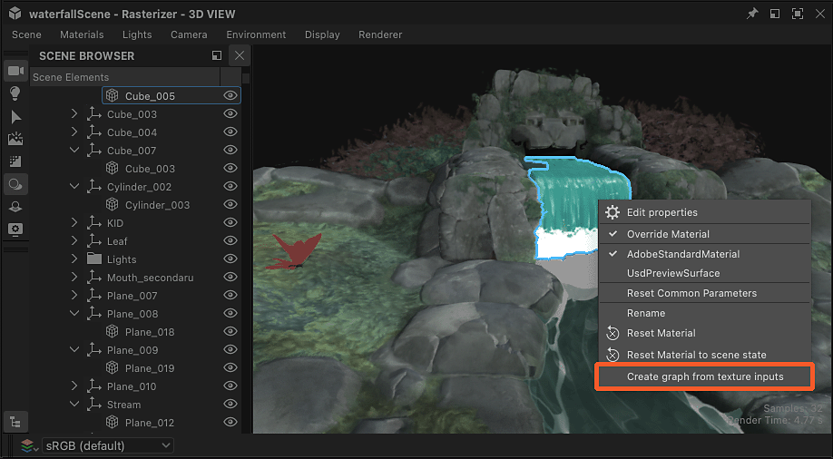{zoomable="yes"}

*3D ビュー ビューポートの操作*

</td>
<td style="border: 0;" valign="top">

![テクスチャ入力からグラフを作成 – [マテリアル]メニューの操作](extracting-materials-values-and-textures.resources/createGraphFromTexturesActionMaterials.png "テクスチャ入力からグラフを作成 – [マテリアル]メニューの操作"){zoomable="yes"}

*マテリアルメニューの操作*

</td>
<td style="border: 0;" valign="top">

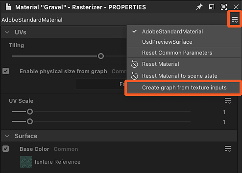{zoomable="yes"}

*プロパティドックのアクション*

</td>
</tr>
</table>

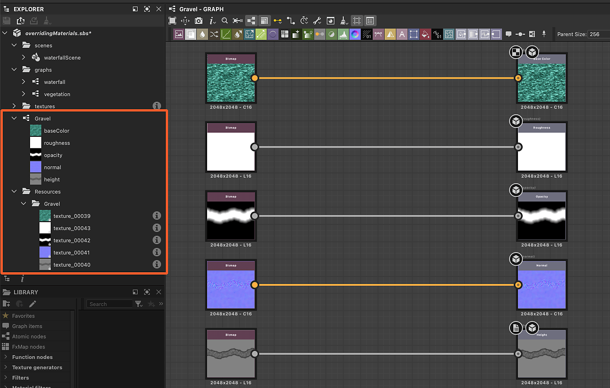{zoomable="yes"}

*テクスチャからグラフを作成した結果*

+++デモンストレーション
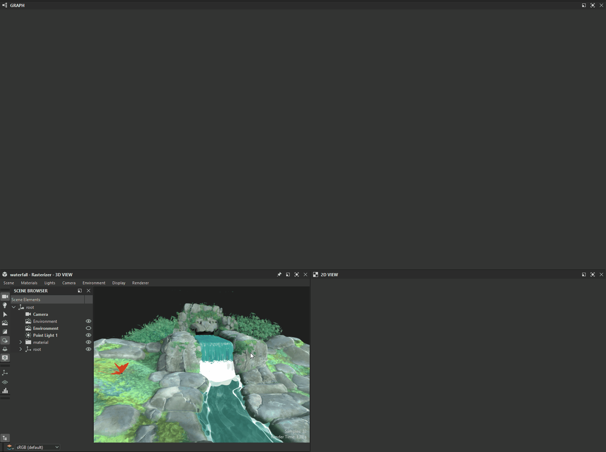{zoomable="yes"}

+++

>[!TIP]
>
> オブジェクトにカーソルを置き<b>Shift + LMB</b>を押して選択すると、3D ビュー ビューポートですばやく直接アクションにアクセスできます。 次に、RMBをクリックして、アクションをホストしているコンテキストメニューにアクセスします。

>[!NOTE]
>
> *埋め込みテクスチャ*&#x200B;を使用するフォーマット（例： USDZ）の場合、テクスチャを抽出してディスクにコピーする必要があります。 その結果、テクスチャを抽出する場所を選択する手順が追加されます。

## テクスチャを抽出

「テクスチャをグラフに抽出」操作を実行すると、マテリアルで使用されるテクスチャの既存のグラフに新しいビットマップノードが作成されます。

このアクションを使用すると、いくつかの処理が行われます。

* [ビットマップリソース](../../resources/bitmap-resource/bitmap-resource.md)は、マテリアルで使用されるテクスチャに対して作成され、&#39;Resources&#39;フォルダーの下の、マテリアルの名前の付いたフォルダーに配置されます。
* 選択したグラフで、そのビットマップリソースに対して[Bitmap](../../compositing-graphs/nodes-reference-for-com/atomic-nodes/bitmap/bitmap.md)ノードが作成され、そのノードを使用して、マテリアルプロパティの後に構成された[Output](../../compositing-graphs/nodes-reference-for-com/atomic-nodes/output/output.md) テクスチャに自動的に接続されます。

ノードプロパティ&#x200B;*に対して構成された出力がグラフ内に既に存在する*&#x200B;場合、*マテリアルは作成されず*&#x200B;ビットマップリソースのみが作成されます。

例： 「Base color」プロパティのテクスチャを、「Base color」用に構成された出力ノードを既にホストしているグラフに展開すると、そのグラフにはノードが作成されません。

<table>
<tr style="border: 0;">
<td style="border: 0;" valign="top">

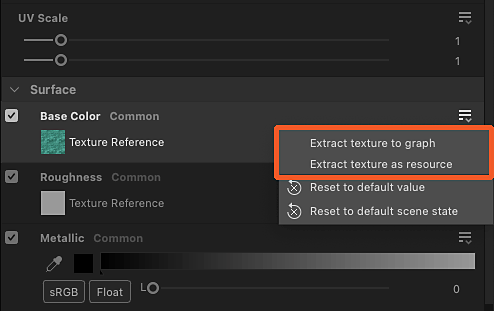{zoomable="yes"}

プロパティドックの「マテリアル」プロパティのアクション

</td>
<td style="border: 0;" valign="top">

![テクスチャからグラフへの抽出 – [展開先グラフの選択]ダイアログ](extracting-materials-values-and-textures.resources/extractTextureSelectGraph.png "テクスチャからグラフへの抽出 – [展開先グラフの選択]ダイアログ"){zoomable="yes"}

「保存先グラフーを選択」ダイアログ

</td>
<td style="border: 0;" valign="top">

</td>
</tr>
</table>

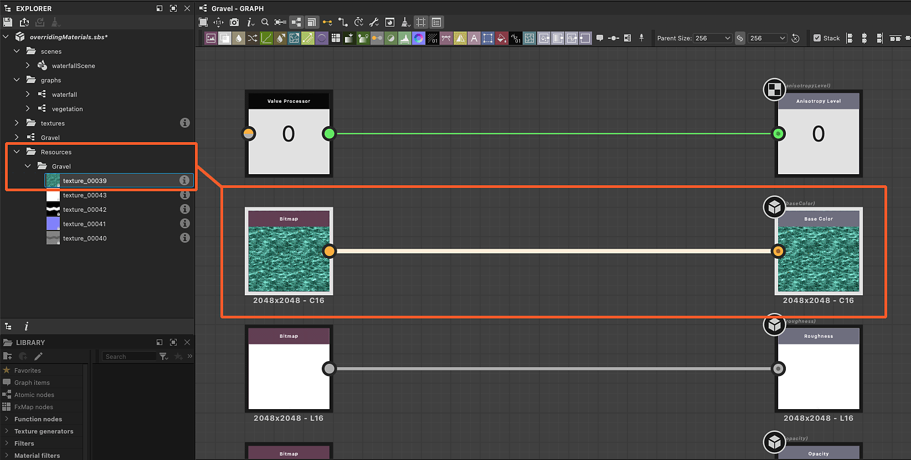{zoomable="yes"}

テクスチャの抽出結果

+++デモンストレーション
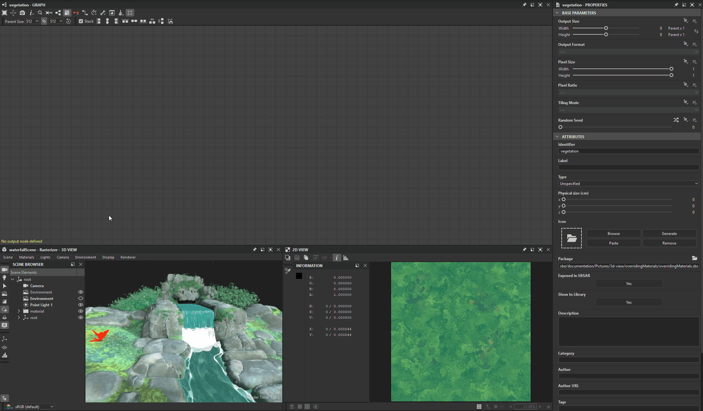{zoomable="yes"}

+++

[テクスチャをリソースとして抽出する]操作では、マテリアルで使用されるテクスチャのビットマップリソースのみが作成され、そのマテリアルの名前が付いたフォルダ内の[Resources]フォルダに配置されます。

>[!NOTE]
>
> *埋め込みテクスチャ*&#x200B;を使用するフォーマット（例： USDZ）の場合、テクスチャを抽出してディスクにコピーする必要があります。 その結果、テクスチャを抽出する場所を選択するための追加の手順が実行されます。

## 値を抽出

&#39;グラフに値を抽出する&#39;操作を実行すると、マテリアルプロパティ値の既存のグラフに新しい[バリュープロセッサー](../../compositing-graphs/nodes-reference-for-com/atomic-nodes/value-processor/value-processor.md)ノードが作成されます。

このアクションを使用すると、いくつかの処理が行われます。

* 選択したグラフで、そのプロパティ値に対して[バリュープロセッサー](../../compositing-graphs/nodes-reference-for-com/atomic-nodes/value-processor/value-processor.md)ノードが作成され、そのマテリアルプロパティの後に構成された[出力](../../compositing-graphs/nodes-reference-for-com/atomic-nodes/output/output.md)ノードに自動的に接続されます。
* バリュープロセッサーノードの[Substance関数グラフ](../../function-graphs/function-graphs.md)で、値の種類に一致する[定数ノード](../../function-graphs/nodes-reference-for-fun/atomic-function-nodes/constant-nodes/constant-nodes.md)が作成され、グラフの出力として設定された抽出値に設定されます。

ノードプロパティ&#x200B;*に対して構成された出力がグラフ内に既に存在する*&#x200B;場合、*マテリアルは作成されません*。

例： 「Anisotropy level」プロパティの値を、「Anisotropy level」用に構成された出力ノードを既にホストしているグラフに展開すると、そのグラフにはノードが作成されません。

<table>
<tr style="border: 0;">
<td style="border: 0;" valign="top">

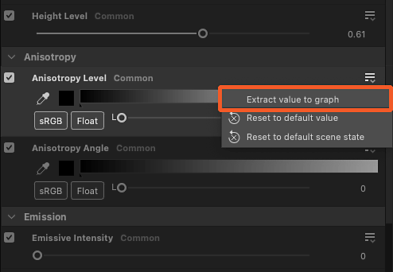{zoomable="yes"}

プロパティドックの「マテリアル」プロパティのアクション

</td>
<td style="border: 0;" valign="top">

![値をグラフに抽出 – [対象グラフの選択]ダイアログ](extracting-materials-values-and-textures.resources/extractValueSelectGraph.png "値をグラフに抽出 – [対象グラフの選択]ダイアログ"){zoomable="yes"}

「保存先グラフーを選択」ダイアログ

</td>
<td style="border: 0;" valign="top">

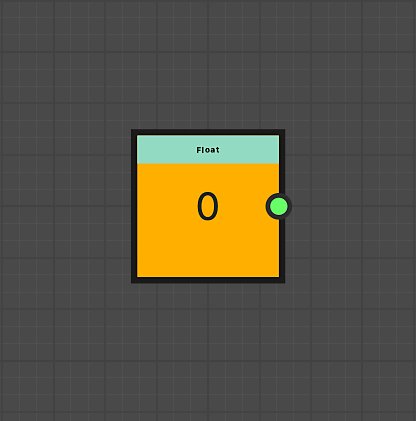{zoomable="yes"}

バリュープロセッサーノードの関数の定数ノード

</td>
</tr>
</table>

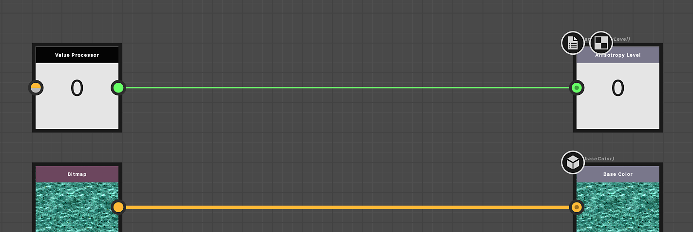{zoomable="yes"}

値の抽出結果

+++デモンストレーション
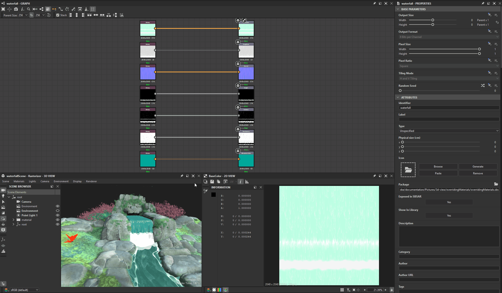{zoomable="yes"}

+++
